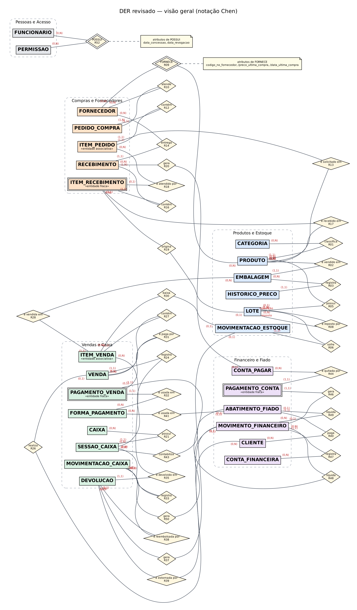
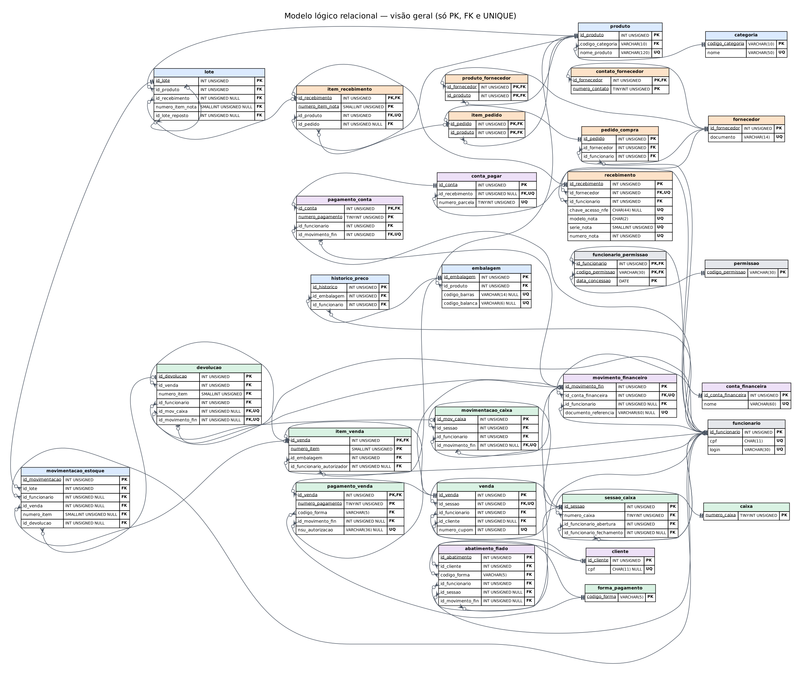

# Projeto ERP — Supermercado Parque Boturussu

Banco de dados para a gestão de um mercado de bairro: compras, estoque por lote e validade, vendas e caixa, fiado, contas a pagar, conciliação de cartão/Pix e previsão de caixa. Projeto Integrador de Modelagem de Dados — do modelo conceitual ao banco implementado em MySQL 8.

**Executar tudo em um comando** (MySQL 8.0.16 ou superior):

```
mysql -u root -p --default-character-set=utf8mb4 < sql/script_completo.sql
```

Documento completo da entrega (formatado conforme a ABNT): [`docs/entrega-final/Grupo_03.pdf`](docs/entrega-final/Grupo_03.pdf).

---

## 1. Identificação do projeto

| | |
|---|---|
| Instituição | Universidade Cidade de São Paulo — Engenharia de Software |
| Disciplina | Modelagem de banco de dados (Projeto Integrador, 2º semestre de 2026) |
| Professor | Clovis Jose Ramos Ferraro |
| Empresa estudada | Supermercado Parque Boturussu (São Paulo – SP) |
| SGBD | MySQL 8.0 (testado em 8.0.46), InnoDB, utf8mb4 |
| Banco | `mercado_boturussu` — 30 tabelas, 14 views, 55 FKs, 20 UNIQUE, 92 CHECK |

## 2. Integrantes

Identificação omitida nesta versão: por orientação do professor, a documentação é avaliada às cegas. A participação individual de cada integrante fica registrada no histórico de commits deste repositório e no diário de bordo, entregue separadamente. A organização do trabalho por blocos está em [`CONTRIBUICAO.md`](CONTRIBUICAO.md).

## 3. Empresa e problema

Mercado de bairro com dois caixas e seis funcionários, que controlava quase tudo em cadernos e de memória. Na entrevista com o gerente (100 perguntas) apareceram os problemas que orientam o projeto: produtos vencendo sem aviso (a lista de validades é a prioridade nº 1), estoque sem origem verificável, fiado anotado em caderno e “riscado” ao pagar, boletos pagos em parte ou com atraso sem controle, nenhuma noção do lucro do dia, e o pedido explícito de um **alerta quando o dinheiro não for dar para as contas**.

## 4. Solução proposta

Um banco relacional que registra cada fato do negócio no nível em que ele acontece — a linha da nota, o lote com sua validade e seu custo, cada item vendido e cada lote que ele consumiu, cada transação de pagamento, cada pagamento parcial de uma conta — e que calcula (em views) tudo o que é derivado: estoque, lucro, saldo do fiado, situação das contas, previsão de caixa. Quem fez cada operação fica registrado, com controle por permissão individual.

## 5. Requisitos e regras de negócio

45 requisitos funcionais, 13 não funcionais, 42 regras de negócio e 14 políticas, cada um rastreado até o problema que o originou. Versão final, com as alterações desta entrega marcadas: [`docs/requisitos/requisitos-e-regras.md`](docs/requisitos/requisitos-e-regras.md). Fluxogramas dos processos: [`docs/diagramas/fluxogramas/`](docs/diagramas/fluxogramas/).

## 6. DER atualizado

27 entidades e 52 relacionamentos, em 5 módulos (Produtos e Estoque, Compras e Fornecedores, Vendas e Caixa, Financeiro e Fiado, Pessoas e Acesso).



Diagramas por módulo e o DER completo (SVG) em [`docs/diagramas/der/`](docs/diagramas/der/). O que mudou em relação à primeira entrega, e por quê: [`docs/revisao/alteracoes-do-modelo.md`](docs/revisao/alteracoes-do-modelo.md).

## 7. Modelo lógico

Regras de conversão, entidade → tabela, relacionamento → FK (com a prova de que nulidade e unicidade de cada FK correspondem à cardinalidade do DER), justificativa de cada PK, entidades fracas × associativas, FKs compostas e restrições: [`docs/modelo-logico/modelo-logico.md`](docs/modelo-logico/modelo-logico.md). Diagramas: [`docs/diagramas/logico/`](docs/diagramas/logico/).



## 8. Normalização

1FN, 2FN e 3FN demonstradas com casos reais do projeto no formato *estrutura → dependência funcional → problema → correção*, incluindo três atributos que a normalização desta fase retirou das tabelas e a única redundância mantida de propósito (e como ela é protegida): [`docs/normalizacao/normalizacao.md`](docs/normalizacao/normalizacao.md).

## 9. Dicionário de Dados

Todas as 232 colunas com tabela, descrição, tipo, tamanho, PK, FK, NULL, UNIQUE, DEFAULT e regra, além das views: [`docs/dicionario-dados/dicionario-dados.md`](docs/dicionario-dados/dicionario-dados.md) (e `.csv`). O dicionário é gerado da mesma fonte do `CREATE TABLE` e conferido automaticamente com o banco criado: **0 divergências** ([evidência](evidencias/08_conferencia_dicionario_x_banco.md)).

## 10. Implementação SQL

| Pasta / arquivo | Conteúdo |
|---|---|
| `sql/ddl/01_banco.sql` | CREATE DATABASE |
| `sql/ddl/02_tabelas.sql` | CREATE TABLE com PK, FK, UNIQUE, CHECK, NOT NULL e DEFAULT (todas com nome) |
| `sql/ddl/03_views.sql` | Views dos atributos derivados |
| `sql/dados/04_massa_dados.sql` | INSERT da massa de dados |
| `sql/consultas/05_consultas_gerenciais.sql` | 16 consultas gerenciais |
| `sql/auditoria/06_consultas_auditoria.sql` | 22 consultas de auditoria |
| `sql/dml/07_operacoes_update_delete.sql` | 9 operações UPDATE/DELETE sobre achados reais |
| `sql/testes/08_testes_restricoes.sql` | 32 testes negativos (cada comando deve falhar) |
| `sql/script_completo.sql` | 01 a 07 em sequência |

Testes negativos: `mysql -u root -p --default-character-set=utf8mb4 --force mercado_boturussu < sql/testes/08_testes_restricoes.sql` (cada teste fica entre `START TRANSACTION` e `ROLLBACK`; nada é gravado).

Execução integral em banco vazio, com código de saída 0: [`evidencias/01_execucao_script_completo.log`](evidencias/01_execucao_script_completo.log).

## 11. Massa de Dados

30 dias de operação simulada (01 a 30/09/2026), cerca de 18 mil registros, com todos os cenários pedidos na devolutiva: pedido recebido em várias notas, nota com dois lotes do mesmo produto, item vendido de dois lotes com custos diferentes, venda com dois cartões, pagamentos parciais, alterações de preço, devoluções nas quatro formas de reembolso, troca com fornecedor e mais. Gerada por um simulador determinístico ([`ferramentas/gerador_massa/`](ferramentas/gerador_massa/)); uso de IA e prompts em [`docs/ia/prompts-ia.md`](docs/ia/prompts-ia.md); cobertura e coerência em [`evidencias/02_validacao_massa_dados.md`](evidencias/02_validacao_massa_dados.md).

## 12. Consultas Gerenciais

16 consultas, cada uma partindo de uma pergunta do gerente e terminando em uma decisão — produtos que mais faturam e lucram, curva ABC, lucro do dia, lista de validades, pedido sugerido, fiado, contas em aberto, **previsão de caixa para 21 dias com alerta**, perdas, melhor fornecedor, pendências de entrega, desempenho por operador, margem por setor, giro e juros por atraso. Pergunta, SQL, resultado real e decisão: [`docs/consultas/consultas-gerenciais-e-auditoria.md`](docs/consultas/consultas-gerenciais-e-auditoria.md). Saída completa: [`evidencias/03_resultados_consultas_gerenciais.txt`](evidencias/03_resultados_consultas_gerenciais.txt).

## 13. Consultas de Auditoria

22 consultas que procuram dados que não deveriam existir — venda cujo pagamento não fecha, item sem baixa de estoque, lote sem validade, diferença de caixa sem justificativa, repasse com taxa errada, operação feita por quem não tinha permissão, cardinalidades mínimas que a FK não garante, entre outras. Executadas antes e depois das ações do gerente: [`evidencias/04_resultados_auditoria_antes.txt`](evidencias/04_resultados_auditoria_antes.txt) e [`evidencias/06_resultados_auditoria_depois.txt`](evidencias/06_resultados_auditoria_depois.txt).

## 14. Potencial para BI e IA

12 indicadores com o valor real do mês, 4 painéis prototipados a partir do banco e 5 possibilidades de IA no formato *problema → dados → análise → benefício* (previsão de demanda, risco de vencimento por lote, previsão de caixa com vendas futuras, anomalias de caixa e preço, apoio ao crédito do fiado), com o que ainda falta para cada uma: [`docs/bi-ia/analise-bi-ia.md`](docs/bi-ia/analise-bi-ia.md).

## 15. Histórico / evolução do projeto

| Etapa | Material |
|---|---|
| Primeira entrega revisada após a devolutiva (sem identificação dos autores) | [`docs/entrega-1-revisada/`](docs/entrega-1-revisada/) |
| Alterações feitas na entrega final, com como foram descobertas | [`docs/revisao/alteracoes-do-modelo.md`](docs/revisao/alteracoes-do-modelo.md) |
| Entrega final | [`docs/entrega-final/`](docs/entrega-final/) |
| Preparação da defesa | [`apresentacao/roteiro-defesa.md`](apresentacao/roteiro-defesa.md) |

O histórico de commits deste repositório é a outra metade desta seção: ele deve mostrar a contribuição de cada integrante ao longo do tempo ([`CONTRIBUICAO.md`](CONTRIBUICAO.md)).

## 16. Conclusão

O banco representa o negócio e funciona de maneira consistente — e isso está provado, não só afirmado: o modelo lógico foi conferido por programa contra o DER, o dicionário contra o banco, o script roda do zero sem erro, o banco recusou as 32 tentativas de violar regras e as consultas respondem às perguntas que o gerente fez. O processo também revelou erros que o papel não mostrava (compra à vista sem saída de dinheiro, situação de caixa contraditória, permissão apagada que “sujava” o passado, cardinalidade desmentida pela venda cancelada), todos corrigidos e registrados. Limites conhecidos: massa fictícia de 30 dias (boa para testar, insuficiente para treinar IA) e histórico de taxas e de limites de fiado ainda não guardado.

---

**Reprodutibilidade.** Todo o conteúdo gerado (DDL, massa, dicionário, diagramas lógicos, evidências) sai de `ferramentas/gerador_massa/` — ver [`ferramentas/README.md`](ferramentas/README.md).
