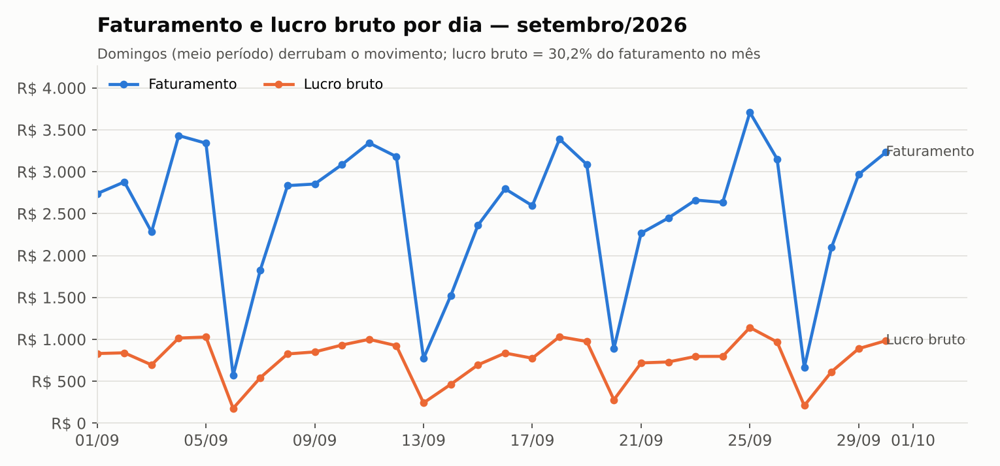
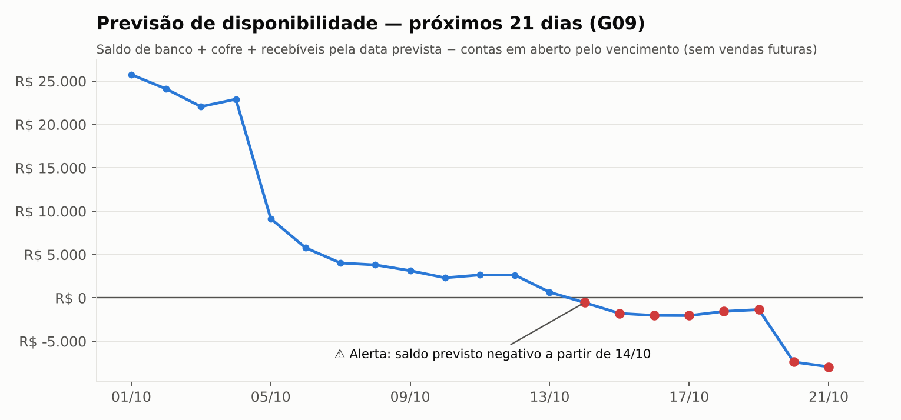
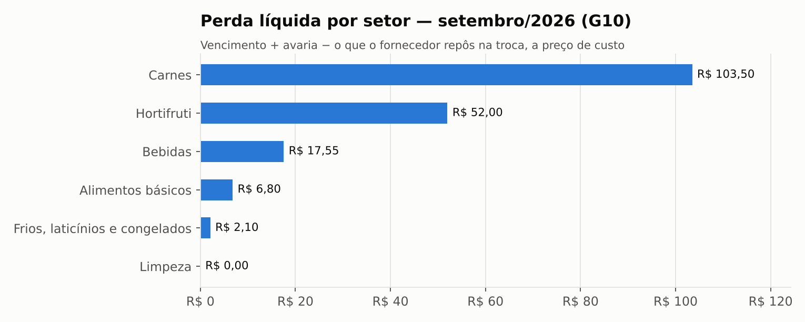
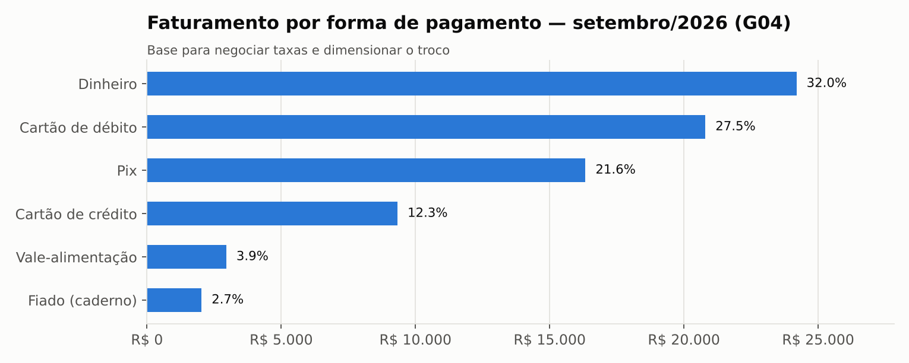

# Análise de dados, BI e possibilidades de IA

*Extraído da seção 10 do documento da entrega final. Gráficos gerados do banco implementado.*

## 10.1 Informações estratégicas que o banco passa a produzir

Antes do sistema, o gerente não sabia o lucro do dia, quanto perdia com vencimento, quanto devia no fiado nem se o dinheiro daria para os boletos da semana (problemas PB da primeira entrega). O banco implementado transforma cada um desses pontos em uma informação mensurável:

| Pergunta estratégica | Dado que a responde (já gravado) | Por que só agora é possível |
|---|---|---|
| Quanto lucro cada produto e setor deixa? | Preço praticado no item × custo de cada lote baixado | O custo por lote (devolutiva, ponto 2) dá o lucro real, não estimado |
| Quanto se perde e por quê? | Movimentações de perda com motivo, responsável e custo | Antes a perda não era registrada (PB-04) |
| O dinheiro vai dar? | Saldo realizado + recebíveis por data prevista − contas por vencimento | Conciliação e pagamentos parciais (pontos 4 e 5) |
| Quanto custa cada forma de pagamento? | Forma, valor e taxa contratada de cada transação | Pagamento por transação, com NSU |
| Quem fez o quê? | Funcionário em cada venda, preço, perda, caixa, devolução | Controle por permissão com vigência |

## 10.2 Indicadores propostos — com o valor real de setembro/2026

| Indicador | Fórmula | Fonte no banco | Valor em set/2026 | Frequência | Decisão que apoia |
|----------------|------------------------|----------------|------------------|----------|----------------|
| Faturamento líquido do mês | Σ total das vendas concluídas − reembolsos | vw_venda_resumo | R$ 75.605,79 | Diária e mensal | Meta de vendas; comparação entre meses |
| Margem bruta | (faturamento − custo dos lotes baixados) ÷ faturamento | vw_venda_resumo, vw_item_venda_resultado | 30,2% (lucro R$ 22.806,27) | Diária | Rever preço do setor abaixo da política (G14) |
| Ticket médio | faturamento ÷ nº de vendas | vw_venda_resumo | R$ 34,24 (2208 vendas) | Diária | Ações para aumentar itens por compra |
| Custo das taxas de cartão/vale | Σ valor × taxa contratada da forma | pagamento_venda, forma_pagamento | R$ 784,61 (1,04% do faturamento) | Mensal | Negociar taxa; incentivar Pix |
| Perda líquida de estoque | (vencimento + avaria − reposição do fornecedor) ÷ custo vendido | vw_movimentacao_valorizada | R$ 181,95 (0,34% do CMV) | Semanal | Comprar menos do que vence; trocar antes |
| Valor em risco de vencimento (7 dias) | Σ saldo × custo dos lotes que vencem em até 7 dias | vw_lote_saldo (G05) | R$ 339,81 | Diária (abertura) | Promover ou negociar troca |
| Itens abaixo do estoque mínimo | nº de produtos com estoque < mínimo | vw_estoque_produto (G06) | 6 produtos | Diária | Pedido do dia |
| Atendimento dos pedidos (fill rate) | % de itens pedidos (até 27/09) recebidos por completo | vw_item_pedido_pendencia | 99,4% | Mensal por fornecedor | Cobrar ou trocar fornecedor |
| Fiado em aberto / em risco | Σ saldo devedor; parte de clientes que não estão “em dia” | vw_cliente_saldo (G07) | R$ 952,23 / R$ 149,01 | Semanal | Cobrar, reduzir limite (PO-04) |
| Contas vencidas e juros pagos | Σ saldo de contas vencidas; Σ juros/multa pagos no mês | vw_conta_pagar_situacao, pagamento_conta | R$ 390,78 vencidas; R$ 29,51 de juros em setembro | Diária | Priorizar pagamento (PO-06) |
| Dias até saldo previsto negativo | 1º dia em que a previsão (G09) fica abaixo de zero | G09 (views financeiras) | 14/10 (13 dias após 01/10) | Diária | Antecipar recebível, negociar prazo |
| Conciliação de recebíveis | créditos conciliados sem divergência ÷ créditos de repasse/Pix | vw_conciliacao | 487 conciliados, 1 divergente(s) | Diária (PO-14) | Contestar a operadora |

Os valores acima foram calculados no banco implementado. Dois deles merecem leitura crítica:

- **Margem bruta de 30,2% contra a política de 35% a 40% (PO-09).** A política, como dita na entrevista, parece se referir a **markup sobre o custo**, não a margem sobre a venda: um markup de 35% corresponde a uma margem de 25,9%. A consulta G14 calcula as duas medidas. Em markup, alimentos básicos (34,1%) ficaram abaixo da política e hortifruti (68,6%) bem acima. Essa ambiguidade é uma **pergunta a confirmar com o gerente** — e a resposta muda a precificação.
- **Perda líquida de 0,34% do custo vendido.** É baixa porque a massa simulou a política de troca com o fornecedor funcionando (o presunto vencido foi reposto). O indicador serve justamente para mostrar quando a troca deixa de acontecer.

## 10.3 Possibilidades de BI: painéis

Não é preciso uma ferramenta de BI completa para demonstrar o potencial: as views já são uma camada semântica pronta para qualquer ferramenta (Power BI, Metabase, Looker Studio) se conectar ao MySQL. Os gráficos abaixo foram gerados **a partir do banco implementado**, como protótipo de quatro painéis.

**Painel 1 — Vendas e resultado.** Pergunta: como as vendas e o lucro evoluem? Dados: `vw_venda_resumo` (venda + itens + custo dos lotes). Decisão: escala de funcionários e promoções nos dias fracos.

*Figura 14 – Faturamento e lucro bruto por dia (setembro/2026). Os vales são os domingos, de meio período.*

**Painel 2 — Caixa e previsão.** Pergunta: o dinheiro vai dar? Dados: `vw_conta_financeira_saldo`, `vw_pagamento_venda_previsao`, `vw_conta_pagar_situacao` (resultado da G09). Decisão: o alerta pedido pelo gerente.

*Figura 15 – Previsão de disponibilidade para 21 dias (resultado da consulta G09).*

Leitura correta do gráfico: a previsão é **conservadora de propósito** — não conta as vendas futuras nem as compras futuras. A queda em 05/10 é a folha de pagamento (R$ 13.850,00) e a de 20/10 é o Simples Nacional (R$ 5.110,00). O alerta a partir de 14/10 não significa que o mercado vai “quebrar”; significa que o dinheiro já existente e a receber **não cobre** as contas já assumidas, e que as vendas das próximas duas semanas precisam cobrir a diferença. É exatamente a informação que o gerente disse não ter.

**Painel 3 — Estoque, validade e perdas.** Pergunta: onde o estoque está virando prejuízo? Dados: `vw_lote_saldo`, `vw_movimentacao_valorizada` (G05, G10, G15). Decisão: promover, trocar, comprar menos.

*Figura 16 – Perda líquida por setor, a preço de custo (consulta G10).*

**Painel 4 — Formas de pagamento.** Pergunta: quanto custa receber? Dados: `pagamento_venda`, `forma_pagamento` (G04). Decisão: negociar taxa com a operadora; incentivar Pix.

*Figura 17 – Faturamento por forma de pagamento (consulta G04).*

## 10.4 Possibilidades de IA: problema → dados → análise → benefício

O manual pede para não escrever apenas “o banco poderá ser utilizado por uma IA”. Cada possibilidade abaixo indica o problema real, os dados **que já existem no modelo**, a análise e o benefício — e também o que falta para ela funcionar de verdade.

**IA-1. Previsão de demanda para o pedido de compra**

- PROBLEMA: o pedido é feito “olhando a gôndola” (PB-02, PB-15). Na massa, o Guaraná 2 L zerou (G06) vendendo 18 unidades por dia, e o sal tem estoque para 14 dias (G15).
- DADOS: `item_venda` (quantidade) + `venda.data_hora` (dia, dia da semana, hora) + `embalagem.fator_conversao` + `produto`/`categoria` + `historico_preco` (efeito do preço) + `item_pedido`/`item_recebimento` (prazo de entrega real do fornecedor).
- ANÁLISE: modelo de séries temporais por produto (sazonalidade semanal e mensal; ex.: suavização exponencial ou gradient boosting com variáveis de calendário), prevendo a venda dos próximos *n* dias; pedido sugerido = previsão até a próxima entrega + estoque de segurança − estoque atual − pendente de entrega (G12).
- BENEFÍCIO: menos ruptura (venda perdida) e menos excesso (capital parado e vencimento). Substitui a média simples usada hoje na G06.
- O QUE FALTA: histórico. Trinta dias não mostram sazonalidade mensal nem anual (fim de mês, festas, calor). Com 12 meses de operação real o modelo passa a fazer sentido.

**IA-2. Risco de vencimento por lote**

- PROBLEMA: perda por vencimento (PB-03, PB-04) e a lista de validades como prioridade nº 1.
- DADOS: `lote` (validade, custo, origem) + `vw_lote_saldo` (saldo) + ritmo de venda do produto (`item_venda`) + `categoria.controle_validade_rigoroso`.
- ANÁLISE: classificar cada lote pela probabilidade de **não** ser vendido antes de vencer (saldo ÷ venda diária prevista × dias restantes), com aprendizado a partir das perdas já registradas (`PERDA_VENCIMENTO`).
- BENEFÍCIO: promover o lote certo **antes** de entrar na lista de alerta; negociar a troca com antecedência.

**IA-3. Previsão de fluxo de caixa com vendas futuras**

- PROBLEMA: a G09 é conservadora (não conta vendas futuras); o gerente quer saber se vai faltar dinheiro (PB-13).
- DADOS: histórico de `venda` + `pagamento_venda` (mix de formas e prazos de crédito) + `forma_pagamento` + `conta_pagar` e `pagamento_conta` (padrão de pagamento) + `vw_conciliacao` (atraso real dos repasses).
- ANÁLISE: prever as vendas diárias e convertê-las em entradas de caixa pela data de crédito de cada forma; simular cenários (semana fraca, atraso de repasse).
- BENEFÍCIO: alerta mais realista, com antecedência para antecipar recebíveis ou renegociar prazo — e menos juros (R$ 29,51 pagos em setembro, G16).

**IA-4. Detecção de anomalias no caixa e nos preços**

- PROBLEMA: diferenças de caixa, descontos e alterações de preço sem controle (PB-11, PB-12).
- DADOS: `sessao_caixa` (diferenças), `item_venda` (descontos, autorizador), `historico_preco` (quem, quando, quanto), `devolucao`, `funcionario_permissao`.
- ANÁLISE: detecção de anomalias (ex.: desconto acima do padrão do operador, alteração de preço com variação extrema como a de 11,99 para 1,99, devoluções concentradas em um operador), complementando as auditorias A06, A13 e A15, que só pegam regras explícitas.
- BENEFÍCIO: o erro de preço de 17/09 teria sido sinalizado na hora da alteração, e não depois de quatro vendas com prejuízo.

**IA-5. Apoio à decisão de crédito do fiado**

- PROBLEMA: o fiado é concedido “para quem a gente conhece” (PB-07, PB-08) e só se percebe o atraso quando ele já é grande.
- DADOS: `vw_cliente_saldo`, `abatimento_fiado` (regularidade dos pagamentos), vendas fiadas (`pagamento_venda` FIADO).
- ANÁLISE: classificação de risco de atraso pelo histórico de compras e pagamentos, explicável (quais fatores pesaram).
- BENEFÍCIO: limite sugerido para cada cliente. A decisão continua com o gerente (PO-04); com dados pessoais, o uso deve respeitar a LGPD (BRASIL, 2018): finalidade, transparência e possibilidade de revisão humana.

## 10.5 O que torna estes dados prontos (ou não) para IA

| Requisito para análise e IA | Situação no banco |
|---|---|
| Data e hora em todo evento | Atende: venda, movimentação, pagamento, alteração de preço, sessão |
| Granularidade fina (item, lote, transação) | Atende: custo por lote, pagamento por transação, movimentação por lote |
| Histórico preservado (não sobrescrito) | Atende: RNF-06, histórico de preço, permissões com vigência |
| Identificação de quem fez | Atende: funcionário em todas as operações sensíveis |
| Qualidade verificável | Atende: 22 auditorias reexecutáveis a qualquer momento |
| Volume e tempo de histórico | **Não atende ainda**: 30 dias simulados. Modelos de previsão precisam de meses de operação real |
| Dados reais | **Não**: a massa é fictícia; serve para testar o modelo, não para treinar uma IA |
| Histórico de taxas e de limites de fiado | **Parcial**: a taxa contratada e o limite de fiado guardam o valor vigente, não o histórico (evolução sugerida) |

