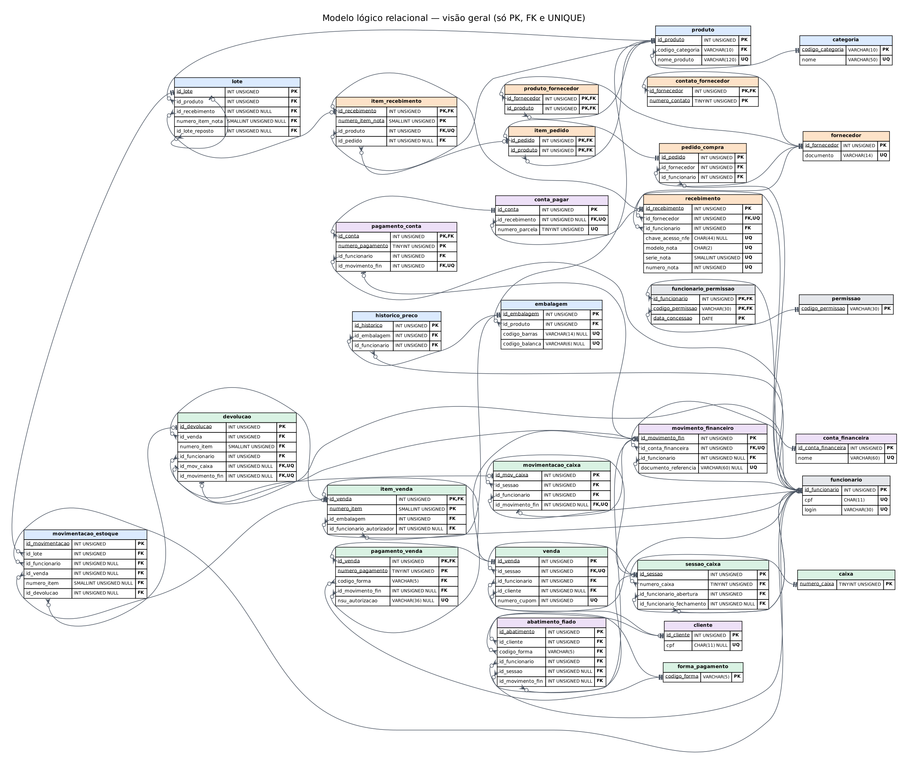
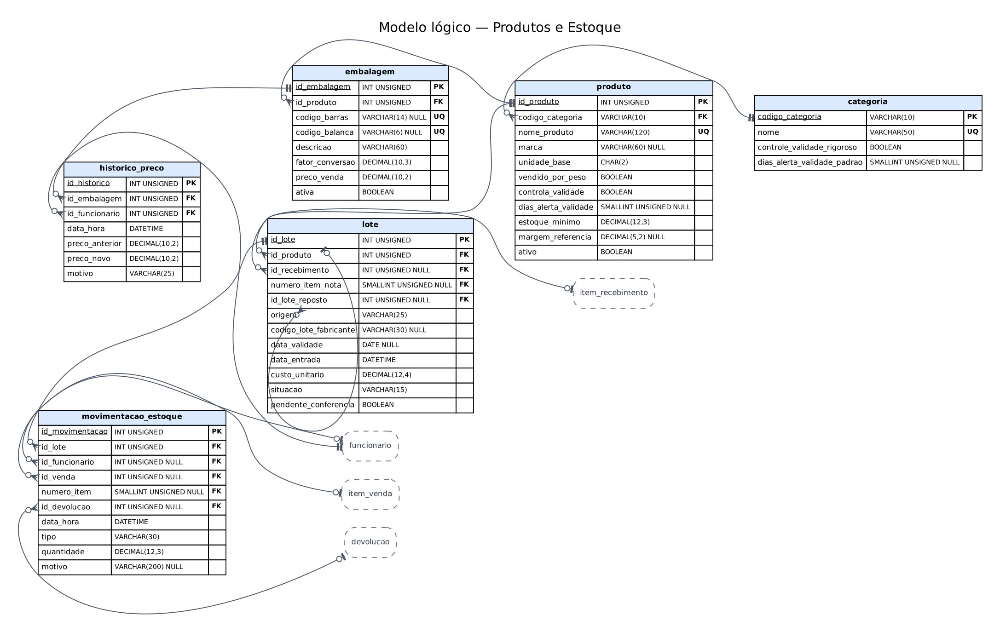
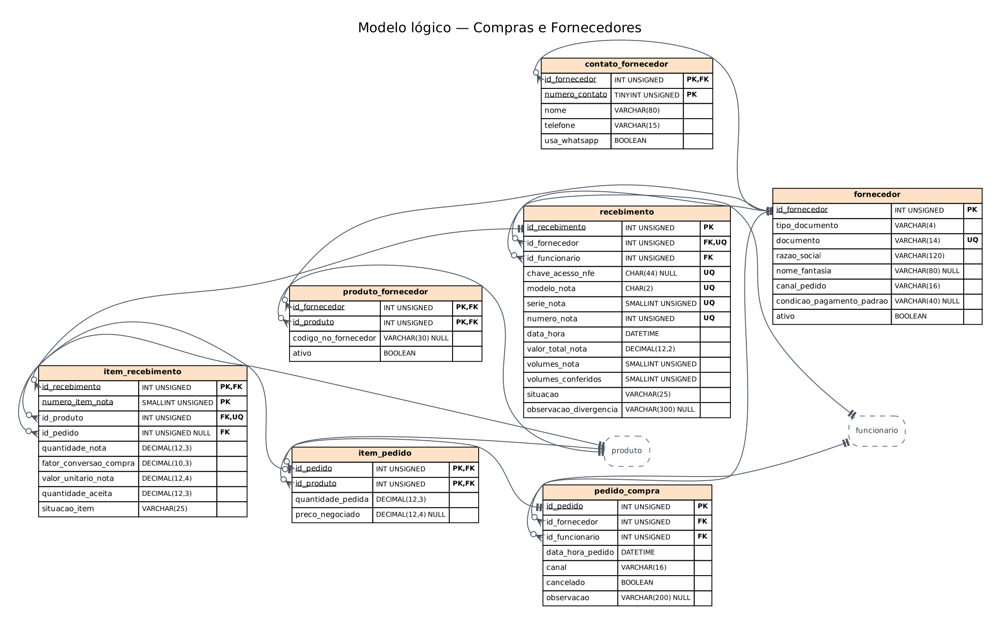
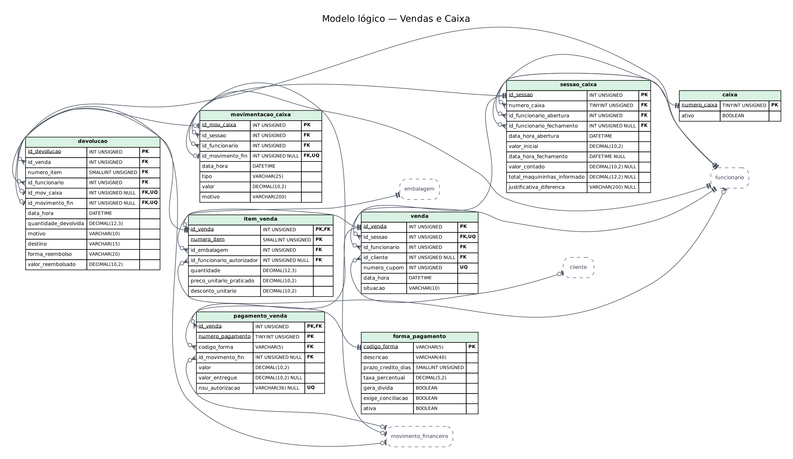
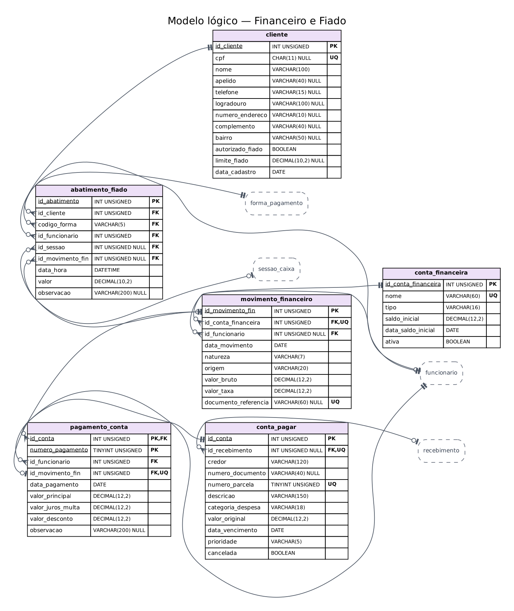
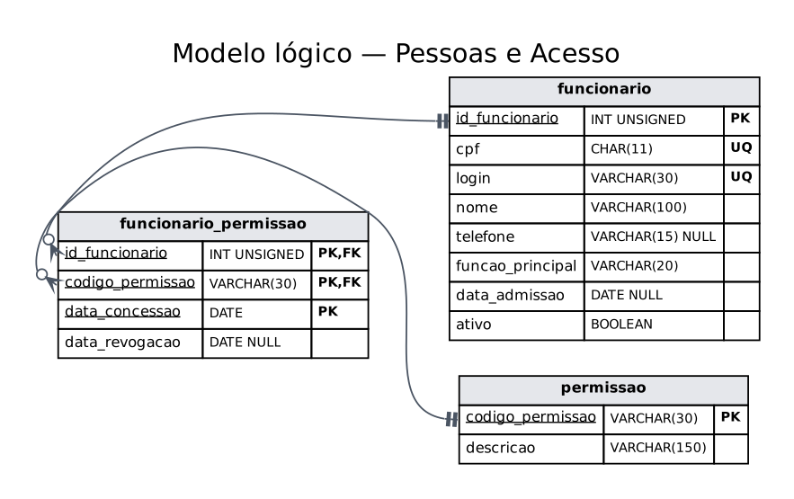

# Projeto lógico do banco de dados (modelo lógico relacional)

*Extraído da seção 3 do documento da entrega final. Diagramas em `docs/diagramas/logico/`.*

## 3.1 Regras de conversão aplicadas

Converter o modelo não foi trocar “entidade” por “tabela”. Cada construção do DER tem uma regra de conversão, seguindo as regras de transformação entre modelos apresentadas por Heuser (2009) e por Elmasri e Navathe (2018), e cada regra tem um motivo:

| Construção no DER | Regra aplicada | Motivo |
|---|---|---|
| Entidade forte | Vira tabela; recebe PK pelo critério D-13 | É uma “coisa” do negócio com identidade própria |
| Entidade fraca | Vira tabela com PK composta: PK da dona (também FK) + discriminador do negócio | A linha só existe e só é identificada dentro da dona (ex.: linha 3 da nota 1.036) |
| Entidade associativa | Vira tabela com PK composta pelas FKs ou por FK + discriminador | Guarda o que pertence ao par (quantidade, preço praticado) |
| Relacionamento 1:N | FK no lado N. Mínimo 1 do lado N ⇒ FK NOT NULL; mínimo 0 ⇒ FK NULL | A tabela do lado N tem um único “pai”; a nulidade traduz a cardinalidade mínima |
| Relacionamento 1:1 | FK no lado em que a participação é opcional, com UNIQUE | UNIQUE impede que o outro lado seja apontado duas vezes (ex.: um pagamento ↔ uma saída de dinheiro) |
| Relacionamento N:N | Tabela associativa com as duas FKs na PK; atributos do relacionamento viram colunas dela | O modelo relacional não guarda listas dentro de uma coluna |
| Autorrelacionamento | FK para a própria tabela | O lote de reposição aponta para o lote trocado (R08) |
| Atributo composto | Uma coluna por componente | Endereço e identificação da nota precisam ser consultados e restringidos por parte (1FN) |
| Atributo multivalorado | Tabela própria | Vários contatos por fornecedor (1FN) |
| Atributo derivado | **Não** vira coluna: é calculado em view | Gravar um valor calculável cria duas verdades que podem divergir (D-21) |

## 3.2 Entidades e associações convertidas em tabelas

| # | Origem no DER | Tabela | Regra de conversão aplicada | PK | Tipo de PK | Colunas |
|-----|---------------|----------------|----------------------------|----------------|---------------|-----|
| 1 | FUNCIONARIO | funcionario | Entidade forte → tabela | id_funcionario | Substituta (AUTO_INCREMENT) | 8 |
| 2 | PERMISSAO | permissao | Entidade forte → tabela | codigo_permissao | Natural (código estável) | 2 |
| 3 | POSSUI (R52) | funcionario_permissao | Relacionamento N:N → tabela associativa | id_funcionario, codigo_permissao, data_concessao | Composta (FK id_funcionario, FK codigo_permissao, discriminador data_concessao) | 4 |
| 4 | CATEGORIA | categoria | Entidade forte → tabela | codigo_categoria | Natural (código estável) | 4 |
| 5 | PRODUTO | produto | Entidade forte → tabela | id_produto | Substituta (AUTO_INCREMENT) | 11 |
| 6 | EMBALAGEM | embalagem | Entidade forte → tabela | id_embalagem | Substituta (AUTO_INCREMENT) | 8 |
| 7 | HISTORICO_PRECO | historico_preco | Entidade forte → tabela | id_historico | Substituta (AUTO_INCREMENT) | 7 |
| 8 | FORNECEDOR | fornecedor | Entidade forte → tabela | id_fornecedor | Substituta (AUTO_INCREMENT) | 8 |
| 9 | FORNECEDOR.contatos | contato_fornecedor | Atributo multivalorado e composto → tabela própria (1FN) | id_fornecedor, numero_contato | Composta (FK id_fornecedor, discriminador numero_contato) | 5 |
| 10 | FORNECE (R09) | produto_fornecedor | Relacionamento N:N → tabela associativa | id_fornecedor, id_produto | Composta (FK id_fornecedor, FK id_produto) | 4 |
| 11 | PEDIDO_COMPRA | pedido_compra | Entidade forte → tabela | id_pedido | Substituta (AUTO_INCREMENT) | 7 |
| 12 | ITEM_PEDIDO | item_pedido | Entidade associativa → tabela com PK composta | id_pedido, id_produto | Composta (FK id_pedido, FK id_produto) | 4 |
| 13 | RECEBIMENTO | recebimento | Entidade forte → tabela | id_recebimento | Substituta (AUTO_INCREMENT) | 13 |
| 14 | ITEM_RECEBIMENTO | item_recebimento | Entidade fraca → tabela com PK composta (dona + discriminador) | id_recebimento, numero_item_nota | Composta (FK id_recebimento, discriminador numero_item_nota) | 9 |
| 15 | LOTE | lote | Entidade forte → tabela | id_lote | Substituta (AUTO_INCREMENT) | 12 |
| 16 | CAIXA | caixa | Entidade forte → tabela | numero_caixa | Natural (código estável) | 2 |
| 17 | SESSAO_CAIXA | sessao_caixa | Entidade forte → tabela | id_sessao | Substituta (AUTO_INCREMENT) | 10 |
| 18 | CLIENTE | cliente | Entidade forte → tabela | id_cliente | Substituta (AUTO_INCREMENT) | 12 |
| 19 | VENDA | venda | Entidade forte → tabela | id_venda | Substituta (AUTO_INCREMENT) | 7 |
| 20 | ITEM_VENDA | item_venda | Entidade associativa → tabela com PK composta | id_venda, numero_item | Composta (FK id_venda, discriminador numero_item) | 7 |
| 21 | CONTA_FINANCEIRA | conta_financeira | Entidade forte → tabela | id_conta_financeira | Substituta (AUTO_INCREMENT) | 6 |
| 22 | MOVIMENTO_FINANCEIRO | movimento_financeiro | Entidade forte → tabela | id_movimento_fin | Substituta (AUTO_INCREMENT) | 9 |
| 23 | FORMA_PAGAMENTO | forma_pagamento | Entidade forte → tabela | codigo_forma | Natural (código estável) | 7 |
| 24 | PAGAMENTO_VENDA | pagamento_venda | Entidade fraca → tabela com PK composta (dona + discriminador) | id_venda, numero_pagamento | Composta (FK id_venda, discriminador numero_pagamento) | 7 |
| 25 | MOVIMENTACAO_CAIXA | movimentacao_caixa | Entidade forte → tabela | id_mov_caixa | Substituta (AUTO_INCREMENT) | 8 |
| 26 | DEVOLUCAO | devolucao | Entidade forte → tabela | id_devolucao | Substituta (AUTO_INCREMENT) | 12 |
| 27 | MOVIMENTACAO_ESTOQUE | movimentacao_estoque | Entidade forte → tabela | id_movimentacao | Substituta (AUTO_INCREMENT) | 10 |
| 28 | ABATIMENTO_FIADO | abatimento_fiado | Entidade forte → tabela | id_abatimento | Substituta (AUTO_INCREMENT) | 9 |
| 29 | CONTA_PAGAR | conta_pagar | Entidade forte → tabela | id_conta | Substituta (AUTO_INCREMENT) | 11 |
| 30 | PAGAMENTO_CONTA | pagamento_conta | Entidade fraca → tabela com PK composta (dona + discriminador) | id_conta, numero_pagamento | Composta (FK id_conta, discriminador numero_pagamento) | 9 |

As 27 entidades do DER geraram 27 tabelas; os dois relacionamentos N:N (FORNECE e POSSUI) geraram 2 tabelas associativas; o atributo multivalorado `contatos` gerou 1 tabela. Total: 30 tabelas.

## 3.3 Relacionamentos convertidos e cardinalidades

O quadro abaixo mostra, para cada um dos 52 relacionamentos do DER, como ele aparece no banco. A coluna “como a cardinalidade aparece” é a prova de que a conversão respeitou o DER: **a nulidade da FK** traduz a cardinalidade mínima do lado que recebe a FK, e **a presença ou ausência de UNIQUE** traduz a máxima do outro lado.

Este quadro não foi preenchido à mão. Ele é produzido por um programa que lê o DER e o modelo lógico e **interrompe a geração do documento** se encontrar um relacionamento sem FK, uma FK sem relacionamento, uma FK opcional onde o DER exige mínimo 1, ou uma FK sem UNIQUE onde o DER exige máximo 1. A geração terminou sem nenhuma dessas falhas.

Há um limite que o quadro também deixa explícito: a FK garante que o “filho” aponta para um “pai” existente, mas **não** garante que todo pai tenha ao menos um filho. Quando o DER exige esse mínimo 1 (ex.: todo pedido tem ao menos um item), a garantia vem da consulta de auditoria indicada na última coluna — e todas elas retornam zero linhas na massa de dados.

| ID | Relacionamento no DER (cardinalidades) | Implementação no modelo lógico | Como a cardinalidade aparece | Mínimo 1 que a FK não garante — onde é verificado |
|-----|--------------------------|--------------------------|-------------------------|------------------|
| R01 | CATEGORIA (0,N) — classifica — PRODUTO (1,1) | produto.(codigo_categoria) → categoria | FK NOT NULL ⇒ cada PRODUTO tem exatamente 1 CATEGORIA; FK sem UNIQUE ⇒ cada CATEGORIA pode ter N PRODUTO | Não se aplica (mínimo 0) |
| R02 | PRODUTO (1,N) — é vendido em — EMBALAGEM (1,1) | embalagem.(id_produto) → produto | FK NOT NULL ⇒ cada EMBALAGEM tem exatamente 1 PRODUTO; FK sem UNIQUE ⇒ cada PRODUTO pode ter N EMBALAGEM | Auditoria A21 (produto ativo sem embalagem ativa) |
| R03 | EMBALAGEM (0,N) — registra — HISTORICO_PRECO (1,1) | historico_preco.(id_embalagem) → embalagem | FK NOT NULL ⇒ cada HISTORICO_PRECO tem exatamente 1 EMBALAGEM; FK sem UNIQUE ⇒ cada EMBALAGEM pode ter N HISTORICO_PRECO | Não se aplica (mínimo 0) |
| R04 | FUNCIONARIO (0,N) — altera — HISTORICO_PRECO (1,1) | historico_preco.(id_funcionario) → funcionario | FK NOT NULL ⇒ cada HISTORICO_PRECO tem exatamente 1 FUNCIONARIO; FK sem UNIQUE ⇒ cada FUNCIONARIO pode ter N HISTORICO_PRECO | Não se aplica (mínimo 0) |
| R05 | PRODUTO (0,N) — possui — LOTE (1,1) | lote.(id_produto) → produto | FK NOT NULL ⇒ cada LOTE tem exatamente 1 PRODUTO; FK sem UNIQUE ⇒ cada PRODUTO pode ter N LOTE | Não se aplica (mínimo 0) |
| R06 | LOTE (1,N) — sofre — MOVIMENTACAO_ESTOQUE (1,1) | movimentacao_estoque.(id_lote) → lote | FK NOT NULL ⇒ cada MOVIMENTACAO_ESTOQUE tem exatamente 1 LOTE; FK sem UNIQUE ⇒ cada LOTE pode ter N MOVIMENTACAO_ESTOQUE | Auditorias A03 e A21 (lote sem movimentação) |
| R07 | FUNCIONARIO (0,N) — registra — MOVIMENTACAO_ESTOQUE (0,1) | movimentacao_estoque.(id_funcionario) → funcionario | FK NULL ⇒ cada MOVIMENTACAO_ESTOQUE tem 0 ou 1 FUNCIONARIO; FK sem UNIQUE ⇒ cada FUNCIONARIO pode ter N MOVIMENTACAO_ESTOQUE | Não se aplica (mínimo 0) |
| R08 | LOTE (0,N) — é reposto por — LOTE (0,1) | lote.(id_lote_reposto) → lote | FK NULL ⇒ cada LOTE tem 0 ou 1 LOTE; FK sem UNIQUE ⇒ cada LOTE pode ter N LOTE | Não se aplica (mínimo 0) |
| R09 | FORNECEDOR (0,N) — FORNECE — PRODUTO (0,N) | Tabela associativa **produto_fornecedor** — PK (id_fornecedor, id_produto); FKs para as duas pontas | N:N: cada linha da associativa liga 1 de cada lado; (0,N) nos dois lados = nenhuma linha obrigatória | — |
| R10 | FORNECEDOR (0,N) — atende — PEDIDO_COMPRA (1,1) | pedido_compra.(id_fornecedor) → fornecedor | FK NOT NULL ⇒ cada PEDIDO_COMPRA tem exatamente 1 FORNECEDOR; FK sem UNIQUE ⇒ cada FORNECEDOR pode ter N PEDIDO_COMPRA | Não se aplica (mínimo 0) |
| R11 | FUNCIONARIO (0,N) — emite — PEDIDO_COMPRA (1,1) | pedido_compra.(id_funcionario) → funcionario | FK NOT NULL ⇒ cada PEDIDO_COMPRA tem exatamente 1 FUNCIONARIO; FK sem UNIQUE ⇒ cada FUNCIONARIO pode ter N PEDIDO_COMPRA | Não se aplica (mínimo 0) |
| R12 | PEDIDO_COMPRA (1,N) — contém — ITEM_PEDIDO (1,1) | item_pedido.(id_pedido) → pedido_compra | FK NOT NULL ⇒ cada ITEM_PEDIDO tem exatamente 1 PEDIDO_COMPRA; FK sem UNIQUE ⇒ cada PEDIDO_COMPRA pode ter N ITEM_PEDIDO | Auditoria A21 (pedido sem itens) |
| R13 | PRODUTO (0,N) — é solicitado em — ITEM_PEDIDO (1,1) | item_pedido.(id_produto) → produto | FK NOT NULL ⇒ cada ITEM_PEDIDO tem exatamente 1 PRODUTO; FK sem UNIQUE ⇒ cada PRODUTO pode ter N ITEM_PEDIDO | Não se aplica (mínimo 0) |
| R14 | FORNECEDOR (0,N) — entrega — RECEBIMENTO (1,1) | recebimento.(id_fornecedor) → fornecedor | FK NOT NULL ⇒ cada RECEBIMENTO tem exatamente 1 FORNECEDOR; FK sem UNIQUE ⇒ cada FORNECEDOR pode ter N RECEBIMENTO | Não se aplica (mínimo 0) |
| R15 | FUNCIONARIO (0,N) — confere — RECEBIMENTO (1,1) | recebimento.(id_funcionario) → funcionario | FK NOT NULL ⇒ cada RECEBIMENTO tem exatamente 1 FUNCIONARIO; FK sem UNIQUE ⇒ cada FUNCIONARIO pode ter N RECEBIMENTO | Não se aplica (mínimo 0) |
| R16 | RECEBIMENTO (1,N) — contém — ITEM_RECEBIMENTO (1,1) | item_recebimento.(id_recebimento) → recebimento | FK NOT NULL ⇒ cada ITEM_RECEBIMENTO tem exatamente 1 RECEBIMENTO; FK sem UNIQUE ⇒ cada RECEBIMENTO pode ter N ITEM_RECEBIMENTO | Auditoria A21 (nota sem linhas) |
| R17 | PRODUTO (0,N) — é recebido em — ITEM_RECEBIMENTO (1,1) | item_recebimento.(id_produto) → produto | FK NOT NULL ⇒ cada ITEM_RECEBIMENTO tem exatamente 1 PRODUTO; FK sem UNIQUE ⇒ cada PRODUTO pode ter N ITEM_RECEBIMENTO | Não se aplica (mínimo 0) |
| R18 | ITEM_PEDIDO (0,N) — é atendido por — ITEM_RECEBIMENTO (0,1) | item_recebimento.(id_pedido, id_produto) → item_pedido (FK composta) | FK NULL ⇒ cada ITEM_RECEBIMENTO tem 0 ou 1 ITEM_PEDIDO; FK sem UNIQUE ⇒ cada ITEM_PEDIDO pode ter N ITEM_RECEBIMENTO | Não se aplica (mínimo 0) |
| R19 | ITEM_RECEBIMENTO (0,N) — origina — LOTE (0,1) | lote.(id_recebimento, numero_item_nota, id_produto) → item_recebimento (FK composta) | FK NULL ⇒ cada LOTE tem 0 ou 1 ITEM_RECEBIMENTO; FK sem UNIQUE ⇒ cada ITEM_RECEBIMENTO pode ter N LOTE | Não se aplica (mínimo 0) |
| R20 | RECEBIMENTO (0,N) — gera — CONTA_PAGAR (0,1) | conta_pagar.(id_recebimento) → recebimento | FK NULL ⇒ cada CONTA_PAGAR tem 0 ou 1 RECEBIMENTO; FK sem UNIQUE ⇒ cada RECEBIMENTO pode ter N CONTA_PAGAR | Não se aplica (mínimo 0) |
| R21 | CAIXA (0,N) — possui — SESSAO_CAIXA (1,1) | sessao_caixa.(numero_caixa) → caixa | FK NOT NULL ⇒ cada SESSAO_CAIXA tem exatamente 1 CAIXA; FK sem UNIQUE ⇒ cada CAIXA pode ter N SESSAO_CAIXA | Não se aplica (mínimo 0) |
| R22 | FUNCIONARIO (0,N) — abre — SESSAO_CAIXA (1,1) | sessao_caixa.(id_funcionario_abertura) → funcionario | FK NOT NULL ⇒ cada SESSAO_CAIXA tem exatamente 1 FUNCIONARIO; FK sem UNIQUE ⇒ cada FUNCIONARIO pode ter N SESSAO_CAIXA | Não se aplica (mínimo 0) |
| R23 | FUNCIONARIO (0,N) — fecha — SESSAO_CAIXA (0,1) | sessao_caixa.(id_funcionario_fechamento) → funcionario | FK NULL ⇒ cada SESSAO_CAIXA tem 0 ou 1 FUNCIONARIO; FK sem UNIQUE ⇒ cada FUNCIONARIO pode ter N SESSAO_CAIXA | Não se aplica (mínimo 0) |
| R24 | SESSAO_CAIXA (0,N) — registra — VENDA (1,1) | venda.(id_sessao) → sessao_caixa | FK NOT NULL ⇒ cada VENDA tem exatamente 1 SESSAO_CAIXA; FK sem UNIQUE ⇒ cada SESSAO_CAIXA pode ter N VENDA | Não se aplica (mínimo 0) |
| R25 | FUNCIONARIO (0,N) — opera — VENDA (1,1) | venda.(id_funcionario) → funcionario | FK NOT NULL ⇒ cada VENDA tem exatamente 1 FUNCIONARIO; FK sem UNIQUE ⇒ cada FUNCIONARIO pode ter N VENDA | Não se aplica (mínimo 0) |
| R26 | CLIENTE (0,N) — realiza — VENDA (0,1) | venda.(id_cliente) → cliente | FK NULL ⇒ cada VENDA tem 0 ou 1 CLIENTE; FK sem UNIQUE ⇒ cada CLIENTE pode ter N VENDA | Não se aplica (mínimo 0) |
| R27 | VENDA (1,N) — contém — ITEM_VENDA (1,1) | item_venda.(id_venda) → venda | FK NOT NULL ⇒ cada ITEM_VENDA tem exatamente 1 VENDA; FK sem UNIQUE ⇒ cada VENDA pode ter N ITEM_VENDA | Auditoria A21 (venda sem itens) |
| R28 | EMBALAGEM (0,N) — é vendida em — ITEM_VENDA (1,1) | item_venda.(id_embalagem) → embalagem | FK NOT NULL ⇒ cada ITEM_VENDA tem exatamente 1 EMBALAGEM; FK sem UNIQUE ⇒ cada EMBALAGEM pode ter N ITEM_VENDA | Não se aplica (mínimo 0) |
| R29 | FUNCIONARIO (0,N) — autoriza desconto — ITEM_VENDA (0,1) | item_venda.(id_funcionario_autorizador) → funcionario | FK NULL ⇒ cada ITEM_VENDA tem 0 ou 1 FUNCIONARIO; FK sem UNIQUE ⇒ cada FUNCIONARIO pode ter N ITEM_VENDA | Não se aplica (mínimo 0) |
| R30 | ITEM_VENDA (0,N) — baixa — MOVIMENTACAO_ESTOQUE (0,1) | movimentacao_estoque.(id_venda, numero_item) → item_venda (FK composta) | FK NULL ⇒ cada MOVIMENTACAO_ESTOQUE tem 0 ou 1 ITEM_VENDA; FK sem UNIQUE ⇒ cada ITEM_VENDA pode ter N MOVIMENTACAO_ESTOQUE | Não se aplica (mínimo 0) |
| R31 | VENDA (0,N) — é paga por — PAGAMENTO_VENDA (1,1) | pagamento_venda.(id_venda) → venda | FK NOT NULL ⇒ cada PAGAMENTO_VENDA tem exatamente 1 VENDA; FK sem UNIQUE ⇒ cada VENDA pode ter N PAGAMENTO_VENDA | Não se aplica (mínimo 0) |
| R32 | FORMA_PAGAMENTO (0,N) — é usada em — PAGAMENTO_VENDA (1,1) | pagamento_venda.(codigo_forma) → forma_pagamento | FK NOT NULL ⇒ cada PAGAMENTO_VENDA tem exatamente 1 FORMA_PAGAMENTO; FK sem UNIQUE ⇒ cada FORMA_PAGAMENTO pode ter N PAGAMENTO_VENDA | Não se aplica (mínimo 0) |
| R33 | SESSAO_CAIXA (0,N) — registra — MOVIMENTACAO_CAIXA (1,1) | movimentacao_caixa.(id_sessao) → sessao_caixa | FK NOT NULL ⇒ cada MOVIMENTACAO_CAIXA tem exatamente 1 SESSAO_CAIXA; FK sem UNIQUE ⇒ cada SESSAO_CAIXA pode ter N MOVIMENTACAO_CAIXA | Não se aplica (mínimo 0) |
| R34 | FUNCIONARIO (0,N) — executa — MOVIMENTACAO_CAIXA (1,1) | movimentacao_caixa.(id_funcionario) → funcionario | FK NOT NULL ⇒ cada MOVIMENTACAO_CAIXA tem exatamente 1 FUNCIONARIO; FK sem UNIQUE ⇒ cada FUNCIONARIO pode ter N MOVIMENTACAO_CAIXA | Não se aplica (mínimo 0) |
| R35 | ITEM_VENDA (0,N) — é devolvido em — DEVOLUCAO (1,1) | devolucao.(id_venda, numero_item) → item_venda (FK composta) | FK NOT NULL ⇒ cada DEVOLUCAO tem exatamente 1 ITEM_VENDA; FK sem UNIQUE ⇒ cada ITEM_VENDA pode ter N DEVOLUCAO | Não se aplica (mínimo 0) |
| R36 | FUNCIONARIO (0,N) — autoriza — DEVOLUCAO (1,1) | devolucao.(id_funcionario) → funcionario | FK NOT NULL ⇒ cada DEVOLUCAO tem exatamente 1 FUNCIONARIO; FK sem UNIQUE ⇒ cada FUNCIONARIO pode ter N DEVOLUCAO | Não se aplica (mínimo 0) |
| R37 | DEVOLUCAO (1,N) — gera — MOVIMENTACAO_ESTOQUE (0,1) | movimentacao_estoque.(id_devolucao) → devolucao | FK NULL ⇒ cada MOVIMENTACAO_ESTOQUE tem 0 ou 1 DEVOLUCAO; FK sem UNIQUE ⇒ cada DEVOLUCAO pode ter N MOVIMENTACAO_ESTOQUE | Auditoria A21 (devolução sem retorno ao estoque) |
| R38 | DEVOLUCAO (0,1) — é reembolsada por — MOVIMENTACAO_CAIXA (0,1) | devolucao.(id_mov_caixa) → movimentacao_caixa | FK NULL ⇒ cada DEVOLUCAO tem 0 ou 1 MOVIMENTACAO_CAIXA; FK UNIQUE ⇒ cada MOVIMENTACAO_CAIXA tem no máximo 1 DEVOLUCAO | Não se aplica (mínimo 0) |
| R39 | DEVOLUCAO (0,1) — é estornada por — MOVIMENTO_FINANCEIRO (0,1) | devolucao.(id_movimento_fin) → movimento_financeiro | FK NULL ⇒ cada DEVOLUCAO tem 0 ou 1 MOVIMENTO_FINANCEIRO; FK UNIQUE ⇒ cada MOVIMENTO_FINANCEIRO tem no máximo 1 DEVOLUCAO | Não se aplica (mínimo 0) |
| R40 | CLIENTE (0,N) — paga — ABATIMENTO_FIADO (1,1) | abatimento_fiado.(id_cliente) → cliente | FK NOT NULL ⇒ cada ABATIMENTO_FIADO tem exatamente 1 CLIENTE; FK sem UNIQUE ⇒ cada CLIENTE pode ter N ABATIMENTO_FIADO | Não se aplica (mínimo 0) |
| R41 | FORMA_PAGAMENTO (0,N) — é usada em — ABATIMENTO_FIADO (1,1) | abatimento_fiado.(codigo_forma) → forma_pagamento | FK NOT NULL ⇒ cada ABATIMENTO_FIADO tem exatamente 1 FORMA_PAGAMENTO; FK sem UNIQUE ⇒ cada FORMA_PAGAMENTO pode ter N ABATIMENTO_FIADO | Não se aplica (mínimo 0) |
| R42 | FUNCIONARIO (0,N) — recebe — ABATIMENTO_FIADO (1,1) | abatimento_fiado.(id_funcionario) → funcionario | FK NOT NULL ⇒ cada ABATIMENTO_FIADO tem exatamente 1 FUNCIONARIO; FK sem UNIQUE ⇒ cada FUNCIONARIO pode ter N ABATIMENTO_FIADO | Não se aplica (mínimo 0) |
| R43 | SESSAO_CAIXA (0,N) — contabiliza — ABATIMENTO_FIADO (0,1) | abatimento_fiado.(id_sessao) → sessao_caixa | FK NULL ⇒ cada ABATIMENTO_FIADO tem 0 ou 1 SESSAO_CAIXA; FK sem UNIQUE ⇒ cada SESSAO_CAIXA pode ter N ABATIMENTO_FIADO | Não se aplica (mínimo 0) |
| R44 | CONTA_PAGAR (0,N) — é quitada por — PAGAMENTO_CONTA (1,1) | pagamento_conta.(id_conta) → conta_pagar | FK NOT NULL ⇒ cada PAGAMENTO_CONTA tem exatamente 1 CONTA_PAGAR; FK sem UNIQUE ⇒ cada CONTA_PAGAR pode ter N PAGAMENTO_CONTA | Não se aplica (mínimo 0) |
| R45 | FUNCIONARIO (0,N) — registra — PAGAMENTO_CONTA (1,1) | pagamento_conta.(id_funcionario) → funcionario | FK NOT NULL ⇒ cada PAGAMENTO_CONTA tem exatamente 1 FUNCIONARIO; FK sem UNIQUE ⇒ cada FUNCIONARIO pode ter N PAGAMENTO_CONTA | Não se aplica (mínimo 0) |
| R46 | PAGAMENTO_CONTA (1,1) — gera — MOVIMENTO_FINANCEIRO (0,1) | pagamento_conta.(id_movimento_fin) → movimento_financeiro | FK NOT NULL ⇒ cada PAGAMENTO_CONTA tem exatamente 1 MOVIMENTO_FINANCEIRO; FK UNIQUE ⇒ cada MOVIMENTO_FINANCEIRO tem no máximo 1 PAGAMENTO_CONTA | Não se aplica (mínimo 0) |
| R47 | CONTA_FINANCEIRA (0,N) — registra — MOVIMENTO_FINANCEIRO (1,1) | movimento_financeiro.(id_conta_financeira) → conta_financeira | FK NOT NULL ⇒ cada MOVIMENTO_FINANCEIRO tem exatamente 1 CONTA_FINANCEIRA; FK sem UNIQUE ⇒ cada CONTA_FINANCEIRA pode ter N MOVIMENTO_FINANCEIRO | Não se aplica (mínimo 0) |
| R48 | MOVIMENTO_FINANCEIRO (0,N) — liquida — PAGAMENTO_VENDA (0,1) | pagamento_venda.(id_movimento_fin) → movimento_financeiro | FK NULL ⇒ cada PAGAMENTO_VENDA tem 0 ou 1 MOVIMENTO_FINANCEIRO; FK sem UNIQUE ⇒ cada MOVIMENTO_FINANCEIRO pode ter N PAGAMENTO_VENDA | Não se aplica (mínimo 0) |
| R49 | MOVIMENTO_FINANCEIRO (0,N) — liquida — ABATIMENTO_FIADO (0,1) | abatimento_fiado.(id_movimento_fin) → movimento_financeiro | FK NULL ⇒ cada ABATIMENTO_FIADO tem 0 ou 1 MOVIMENTO_FINANCEIRO; FK sem UNIQUE ⇒ cada MOVIMENTO_FINANCEIRO pode ter N ABATIMENTO_FIADO | Não se aplica (mínimo 0) |
| R50 | MOVIMENTACAO_CAIXA (0,1) — gera — MOVIMENTO_FINANCEIRO (0,1) | movimentacao_caixa.(id_movimento_fin) → movimento_financeiro | FK NULL ⇒ cada MOVIMENTACAO_CAIXA tem 0 ou 1 MOVIMENTO_FINANCEIRO; FK UNIQUE ⇒ cada MOVIMENTO_FINANCEIRO tem no máximo 1 MOVIMENTACAO_CAIXA | Não se aplica (mínimo 0) |
| R51 | FUNCIONARIO (0,N) — lança — MOVIMENTO_FINANCEIRO (0,1) | movimento_financeiro.(id_funcionario) → funcionario | FK NULL ⇒ cada MOVIMENTO_FINANCEIRO tem 0 ou 1 FUNCIONARIO; FK sem UNIQUE ⇒ cada FUNCIONARIO pode ter N MOVIMENTO_FINANCEIRO | Não se aplica (mínimo 0) |
| R52 | FUNCIONARIO (0,N) — POSSUI — PERMISSAO (0,N) | Tabela associativa **funcionario_permissao** — PK (id_funcionario, codigo_permissao, data_concessao); FKs para as duas pontas | N:N: cada linha da associativa liga 1 de cada lado; (0,N) nos dois lados = nenhuma linha obrigatória | — |

*Figura 8 – Modelo lógico relacional: visão geral com PK, FK e UNIQUE das 30 tabelas.*

*Figura 9 – Modelo lógico: Produtos e Estoque.*

*Figura 10 – Modelo lógico: Compras e Fornecedores (FKs compostas de item_recebimento e lote).*

*Figura 11 – Modelo lógico: Vendas e Caixa.*

*Figura 12 – Modelo lógico: Financeiro e Fiado.*

*Figura 13 – Modelo lógico: Pessoas e Acesso.*

## 3.4 Chaves primárias: por que cada uma

O manual pede para não escolher uma PK “porque todo mundo usa”. O critério (decisão D-13, revista na devolutiva) é:

- **Chave natural** quando existe um código curto, estável e controlado pelo próprio mercado: `categoria.codigo_categoria` (HORTI, BEBID…), `forma_pagamento.codigo_forma` (DIN, PIX, FIADO…), `permissao.codigo_permissao`, `caixa.numero_caixa` (o número pintado no PDV).
- **Chave substituta** (inteiro AUTO_INCREMENT) para cadastros cujas candidatas naturais mudam ou são dados pessoais (nome do produto é corrigido; CPF não deve circular pelas tabelas de venda — RNF-13 e Lei Geral de Proteção de Dados (BRASIL, 2018)) e para eventos (venda, movimentação), em que data/hora colide e o caixa pode operar desconectado (RNF-07).
- **Chave composta** quando a linha só existe dentro de outra: PK da dona + um discriminador que o próprio negócio usa (número da linha impresso na nota, posição no cupom, sequência do pagamento).
- As candidatas naturais **não foram abandonadas**: viraram UNIQUE (CPF, login, nome do produto, código de barras, nota fiscal, NSU da transação). O banco continua impedindo duplicidade; só não usa esses valores para relacionar tabelas.

| Tabela | PK | Tipo | Por que esta é uma boa chave para esta tabela |
|----------------|--------------------|------------------|----------------------------------------------|
| funcionario | id_funcionario | Substituta (AUTO_INCREMENT) | Chave substituta: evita espalhar o CPF pelas tabelas de operação (RNF-13) |
| permissao | codigo_permissao | Natural (código estável) | Chave natural: código fixo definido pelo sistema (D-13) |
| funcionario_permissao | id_funcionario, codigo_permissao, data_concessao | Composta (FK id_funcionario, FK codigo_permissao, discriminador data_concessao) | O par funcionário–permissão se repete no tempo (conceder, revogar, conceder de novo); a data de concessão distingue cada período (D-24). |
| categoria | codigo_categoria | Natural (código estável) | Chave natural controlada pelo mercado (D-13) |
| produto | id_produto | Substituta (AUTO_INCREMENT) | Chave substituta (D-13). Evento ou cadastro sem candidata natural estável; inteiro curto e imutável, barato de propagar como FK |
| embalagem | id_embalagem | Substituta (AUTO_INCREMENT) | Chave substituta (D-13). Evento ou cadastro sem candidata natural estável; inteiro curto e imutável, barato de propagar como FK |
| historico_preco | id_historico | Substituta (AUTO_INCREMENT) | Identificador da alteração |
| fornecedor | id_fornecedor | Substituta (AUTO_INCREMENT) | Chave substituta (D-13). Evento ou cadastro sem candidata natural estável; inteiro curto e imutável, barato de propagar como FK |
| contato_fornecedor | id_fornecedor, numero_contato | Composta (FK id_fornecedor, discriminador numero_contato) | O contato só existe dentro do fornecedor; numero_contato numera os vendedores de cada fornecedor (entidade fraca). |
| produto_fornecedor | id_fornecedor, id_produto | Composta (FK id_fornecedor, FK id_produto) | Um par fornecedor–produto aparece uma única vez; a própria combinação é a identidade (N:N). |
| pedido_compra | id_pedido | Substituta (AUTO_INCREMENT) | Chave substituta: pedido por WhatsApp não tem número |
| item_pedido | id_pedido, id_produto | Composta (FK id_pedido, FK id_produto) | RN-10: cada produto aparece uma única vez no pedido; o par (pedido, produto) é a identidade natural da linha. |
| recebimento | id_recebimento | Substituta (AUTO_INCREMENT) | Chave substituta (D-13). Evento ou cadastro sem candidata natural estável; inteiro curto e imutável, barato de propagar como FK |
| item_recebimento | id_recebimento, numero_item_nota | Composta (FK id_recebimento, discriminador numero_item_nota) | A linha da nota é identificada pela nota e pelo número impresso da linha — mesmo produto pode vir em duas linhas. |
| lote | id_lote | Substituta (AUTO_INCREMENT) | Chave substituta: permite 2 lotes na mesma linha de nota e lotes sem nota (D-02) |
| caixa | numero_caixa | Natural (código estável) | Chave natural estável (D-13) |
| sessao_caixa | id_sessao | Substituta (AUTO_INCREMENT) | Identificador da sessão |
| cliente | id_cliente | Substituta (AUTO_INCREMENT) | Chave substituta (D-13). Evento ou cadastro sem candidata natural estável; inteiro curto e imutável, barato de propagar como FK |
| venda | id_venda | Substituta (AUTO_INCREMENT) | Chave substituta: não depende do relógio, permite caixa offline (RNF-07) |
| item_venda | id_venda, numero_item | Composta (FK id_venda, discriminador numero_item) | Posição no cupom: o mesmo produto pode ser lido duas vezes na mesma venda, então (venda, produto) NÃO serviria. |
| conta_financeira | id_conta_financeira | Substituta (AUTO_INCREMENT) | Identificador |
| movimento_financeiro | id_movimento_fin | Substituta (AUTO_INCREMENT) | Identificador |
| forma_pagamento | codigo_forma | Natural (código estável) | Chave natural fixa: DIN, DEB, CRE, PIX, VALE, FIADO (D-13) |
| pagamento_venda | id_venda, numero_pagamento | Composta (FK id_venda, discriminador numero_pagamento) | Sequência na venda: dois pagamentos na mesma forma (dois cartões) quebrariam uma PK (venda, forma). |
| movimentacao_caixa | id_mov_caixa | Substituta (AUTO_INCREMENT) | Identificador |
| devolucao | id_devolucao | Substituta (AUTO_INCREMENT) | Identificador |
| movimentacao_estoque | id_movimentacao | Substituta (AUTO_INCREMENT) | Chave substituta: duas baixas no mesmo instante não colidem (T05) |
| abatimento_fiado | id_abatimento | Substituta (AUTO_INCREMENT) | Identificador |
| conta_pagar | id_conta | Substituta (AUTO_INCREMENT) | Chave substituta (D-13). Evento ou cadastro sem candidata natural estável; inteiro curto e imutável, barato de propagar como FK |
| pagamento_conta | id_conta, numero_pagamento | Composta (FK id_conta, discriminador numero_pagamento) | Sequência na conta: pagamentos parciais da mesma obrigação (RN-38). |

## 3.5 Entidades fracas e entidades associativas

O manual alerta para não confundir as duas. A diferença usada aqui é a da regra de negócio: a **fraca** depende de outra para existir e ser identificada; a **associativa** representa a ligação entre duas outras e guarda o que pertence ao par.

| Tabela | Classificação | Por que (regra do negócio) | PK |
|--------------------|--------------|----------------------------------------------|--------------------|
| contato_fornecedor | Fraca | Vendedor só existe como contato de um fornecedor; sai junto com ele do contexto do negócio | (id_fornecedor, numero_contato) |
| item_recebimento | Fraca | A linha só existe dentro da nota fiscal; é identificada pelo número impresso na nota | (id_recebimento, numero_item_nota) |
| pagamento_venda | Fraca | Não há pagamento de venda sem a venda; a sequência distingue dois cartões na mesma venda | (id_venda, numero_pagamento) |
| pagamento_conta | Fraca | Pagamento parcial só existe dentro da obrigação que quita | (id_conta, numero_pagamento) |
| item_pedido | Associativa | Resolve PEDIDO_COMPRA × PRODUTO (N:N) e guarda o que é do par: quantidade e preço negociado | (id_pedido, id_produto) |
| item_venda | Associativa | Resolve VENDA × EMBALAGEM e guarda quantidade, preço praticado, desconto e autorizador | (id_venda, numero_item) |
| produto_fornecedor | Associativa (N:N) | Relacionamento FORNECE com atributo do par (código no catálogo do fornecedor) | (id_fornecedor, id_produto) |
| funcionario_permissao | Associativa (N:N) | Relacionamento POSSUI com atributos do par (concessão e revogação) | (id_funcionario, codigo_permissao, data_concessao) |

Duas escolhas merecem defesa:

- **ITEM_VENDA usa (id_venda, numero_item), e não (id_venda, id_embalagem).** O mesmo produto pode ser lido duas vezes no mesmo cupom (o cliente volta com outra unidade, ou uma linha tem desconto e outra não). Com (venda, embalagem) como PK, a segunda leitura seria recusada.
- **ITEM_PEDIDO usa (id_pedido, id_produto).** Aqui o oposto é desejado: a RN-10 diz que cada produto aparece uma única vez no pedido. A PK composta pelas duas FKs implementa a regra sem nenhuma restrição extra.

## 3.6 Chaves compostas e FKs compostas

Além das 8 PKs compostas, o modelo usa 4 FKs compostas. Duas delas resolvem um problema que FKs simples não resolvem — **coerência de produto entre tabelas**:

- `item_recebimento (id_pedido, id_produto) → item_pedido (id_pedido, id_produto)`. Com duas FKs separadas (uma para o pedido, outra para o produto), uma linha de nota de **arroz** poderia apontar para um pedido em que o arroz não foi pedido. A FK composta só aceita a combinação que existe em `item_pedido`. Teste T18 (seção 9.4).
- `lote (id_recebimento, numero_item_nota, id_produto) → item_recebimento (id_recebimento, numero_item_nota, id_produto)`. Impede que um lote de **leite** nasça de uma linha de nota de **café**. Para isso `item_recebimento` declara a superchave `uq_ir_lote_ref (id_recebimento, numero_item_nota, id_produto)` — uma UNIQUE que contém a PK e por isso não muda a identidade da linha, mas permite que a FK referencie também o produto. Teste T16.

As outras duas FKs compostas (`devolucao → item_venda` e `movimentacao_estoque → item_venda`) existem porque a PK de `item_venda` é composta: para apontar para um item do cupom é preciso informar venda e posição.

## 3.7 Restrições

**Princípio:** o banco protege tudo o que pode ser verificado olhando uma única linha (CHECK, NOT NULL), a unicidade (UNIQUE) e a existência do que é referenciado (FK). O que depende de várias linhas ou tabelas — “a soma dos pagamentos é igual ao total da venda”, “a soma dos lotes é igual à quantidade aceita” — não cabe em CHECK no MySQL e é verificado pelas consultas de auditoria (decisão D-20, seção 5).

Nenhuma restrição foi criada “para constar”. Cada uma tem nome próprio (`pk_`, `fk_`, `uq_`, `ck_`) e um motivo registrado; o motivo aparece no dicionário, ao lado da coluna, e no Apêndice B. Exemplos do raciocínio:

| Pergunta do manual | Restrição | Regra protegida |
|---|---|---|
| O CPF não pode se repetir? | `uq_funcionario_cpf`, `uq_cliente_cpf` (UNIQUE) | Uma pessoa, um cadastro |
| A quantidade não pode ser negativa? | `ck_iv_qtd`, `ck_me_qtd`, `ck_ip_qtd` (CHECK > 0) | Venda, movimentação e pedido só com quantidade positiva; o sentido da movimentação vem do tipo |
| O que é obrigatório? | 176 colunas NOT NULL | Ex.: toda venda tem sessão e operador (RN-20, RNF-02) |
| Qual valor assumir quando nada é informado? | 34 DEFAULT | Ex.: lote nasce DISPONIVEL; desconto começa em 0; produto nasce ativo |
| Regra que envolve duas colunas da mesma linha? | `ck_iv_autorizacao`: `desconto_unitario = 0 OR id_funcionario_autorizador IS NOT NULL` | RN-23: desconto só com autorizador |
| Regra condicional? | `ck_dev_dinheiro`: `(forma_reembolso = 'DINHEIRO') = (id_mov_caixa IS NOT NULL)` | RN-28/RN-37: reembolso em dinheiro sempre aparece na gaveta, e só ele |
| Formato de um código? | `ck_receb_nfe_fmt`: 44 posições; `ck_fornecedor_doc`: CPF com 11 dígitos ou CNPJ com 12 posições alfanuméricas + 2 dígitos | Chave de acesso da NF-e e CNPJ no formato vigente |

| Tabela | PK | FK | UNIQUE | CHECK | NOT NULL | DEFAULT |
|--------------------------|--------|--------|----------|----------|------------|------------|
| funcionario | 1 | 0 | 2 | 3 | 6 | 1 |
| permissao | 1 | 0 | 0 | 0 | 2 | 0 |
| funcionario_permissao | 1 | 2 | 0 | 1 | 3 | 1 |
| categoria | 1 | 0 | 1 | 0 | 3 | 1 |
| produto | 1 | 1 | 1 | 4 | 8 | 4 |
| embalagem | 1 | 1 | 2 | 5 | 6 | 1 |
| historico_preco | 1 | 2 | 0 | 2 | 7 | 1 |
| fornecedor | 1 | 0 | 1 | 2 | 6 | 1 |
| contato_fornecedor | 1 | 1 | 0 | 1 | 5 | 1 |
| produto_fornecedor | 1 | 2 | 0 | 0 | 3 | 1 |
| pedido_compra | 1 | 2 | 0 | 1 | 6 | 1 |
| item_pedido | 1 | 2 | 0 | 2 | 3 | 0 |
| recebimento | 1 | 2 | 2 | 7 | 11 | 0 |
| item_recebimento | 1 | 3 | 1 | 5 | 8 | 1 |
| lote | 1 | 3 | 0 | 6 | 7 | 2 |
| caixa | 1 | 0 | 0 | 1 | 2 | 1 |
| sessao_caixa | 1 | 3 | 0 | 3 | 5 | 0 |
| cliente | 1 | 0 | 1 | 4 | 4 | 2 |
| venda | 1 | 3 | 1 | 2 | 6 | 1 |
| item_venda | 1 | 3 | 0 | 4 | 6 | 1 |
| conta_financeira | 1 | 0 | 1 | 1 | 6 | 1 |
| movimento_financeiro | 1 | 2 | 1 | 4 | 7 | 1 |
| forma_pagamento | 1 | 0 | 0 | 2 | 7 | 5 |
| pagamento_venda | 1 | 3 | 1 | 4 | 4 | 0 |
| movimentacao_caixa | 1 | 3 | 1 | 3 | 7 | 0 |
| devolucao | 1 | 4 | 2 | 7 | 10 | 1 |
| movimentacao_estoque | 1 | 4 | 0 | 7 | 5 | 0 |
| abatimento_fiado | 1 | 5 | 0 | 4 | 6 | 0 |
| conta_pagar | 1 | 1 | 1 | 5 | 9 | 3 |
| pagamento_conta | 1 | 3 | 1 | 2 | 8 | 2 |
| **Total** | **30** | **55** | **20** | **92** | **176** | **34** |

**DEFAULT — por que cada valor padrão:**

| Coluna | DEFAULT | Por que este valor padrão |
|--------------------------------|------------------|--------------------------------------------------|
| funcionario.ativo | TRUE | Inativo não opera (RNF-06: não se exclui) |
| funcionario_permissao.data_concessao | CURRENT_DATE | Atributo do relacionamento; compõe a PK para permitir conceder de novo depois de revogar |
| categoria.controle_validade_rigoroso | FALSE | Alimentos básicos = verdadeiro (entrevista 2.15) |
| produto.vendido_por_peso | FALSE | Se verdadeiro, unidade_base = KG (RN-02) |
| produto.controla_validade | TRUE | RN-15 |
| produto.estoque_minimo | 0 | >= 0; dispara alerta (RF-19) |
| produto.ativo | TRUE | Em comercialização |
| embalagem.ativa | TRUE | Pode ser vendida |
| historico_preco.data_hora | CURRENT_TIMESTAMP | Momento da alteração |
| fornecedor.ativo | TRUE | Em uso |
| contato_fornecedor.usa_whatsapp | FALSE | Atende por WhatsApp |
| produto_fornecedor.ativo | TRUE | Par ainda em uso |
| pedido_compra.cancelado | FALSE | Pedido cancelado |
| item_recebimento.fator_conversao_compra | 1 | > 0 (caixa com 12 = 12) |
| lote.situacao | 'DISPONIVEL' | DISPONIVEL, SEPARADO_TROCA, TROCADO, DESCARTADO |
| lote.pendente_conferencia | FALSE | Só em lotes AJUSTE_INVENTARIO (RN-40) |
| caixa.ativo | TRUE | Em uso |
| cliente.autorizado_fiado | FALSE | Só o gerente altera (PO-04) |
| cliente.data_cadastro | CURRENT_DATE | Data do cadastro |
| venda.situacao | 'CONCLUIDA' | CONCLUIDA, CANCELADA |
| item_venda.desconto_unitario | 0 | >= 0 e menor que o preço |
| conta_financeira.ativa | TRUE | Em uso |
| movimento_financeiro.valor_taxa | 0 | >= 0 e <= bruto |
| forma_pagamento.prazo_credito_dias | 0 | DIN/PIX = 0 |
| forma_pagamento.taxa_percentual | 0 | 0 a 100 |
| forma_pagamento.gera_divida | FALSE | Só FIADO |
| forma_pagamento.exige_conciliacao | FALSE | DEB, CRE, PIX, VALE |
| forma_pagamento.ativa | TRUE | Disponível no caixa |
| devolucao.valor_reembolsado | 0 | 0 na troca; > 0 nos demais |
| conta_pagar.numero_parcela | 1 | >= 1 |
| conta_pagar.prioridade | 'MEDIA' | ALTA, MEDIA, BAIXA (PO-06) |
| conta_pagar.cancelada | FALSE | Cancelada |
| pagamento_conta.valor_juros_multa | 0 | >= 0 |
| pagamento_conta.valor_desconto | 0 | >= 0 |

## 3.8 Integridade referencial

- **Toda FK é RESTRICT (padrão do MySQL); nenhuma usa CASCADE** (decisão D-22). Em um sistema de caixa, um `DELETE … CASCADE` em produto apagaria vendas, lotes e movimentações — o histórico que a RNF-06 e a PO-12 mandam preservar. Com RESTRICT, o banco recusa a exclusão de qualquer registro que já tenha sido usado (testes T26, T27 e T28).
- **Registros operacionais não são excluídos: mudam de situação.** Produto e funcionário são inativados (`ativo = FALSE`), venda é cancelada (`situacao = 'CANCELADA'`), permissão é revogada (`data_revogacao`).
- **DELETE só onde nada depende do registro**: um contato de fornecedor que saiu da empresa (cadastro, sem histórico) e um item de pedido que ainda não chegou (planejamento, sem efeito). O script de operações mostra os dois casos e mostra que o banco **recusaria** excluir um item de pedido já recebido (seção 9.3).
- **Ordem de criação**: as tabelas são criadas em uma ordem em que toda tabela referenciada já existe; a verificação é automática no gerador (`check_order`). Por isso o script não precisa desligar a verificação de FKs em nenhum momento.
- **Todas as FKs têm índice**: o InnoDB exige e cria um índice para cada FK, o que também acelera os JOINs das consultas.

