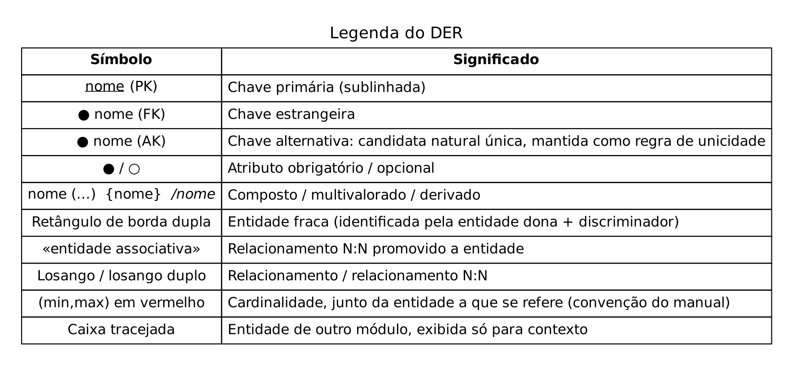
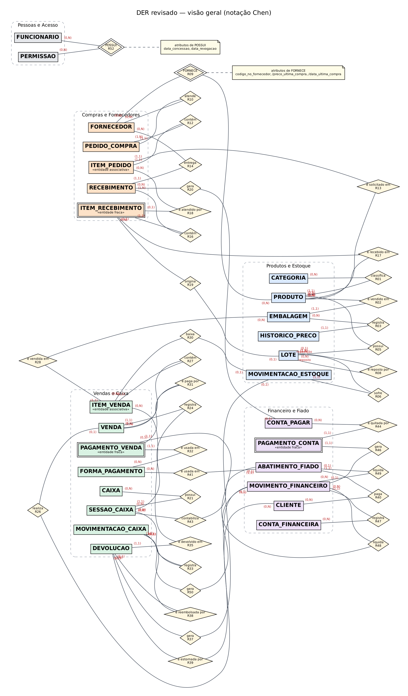
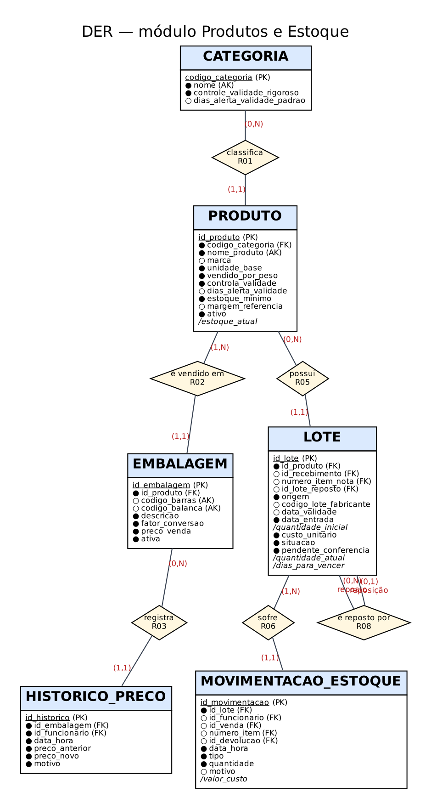
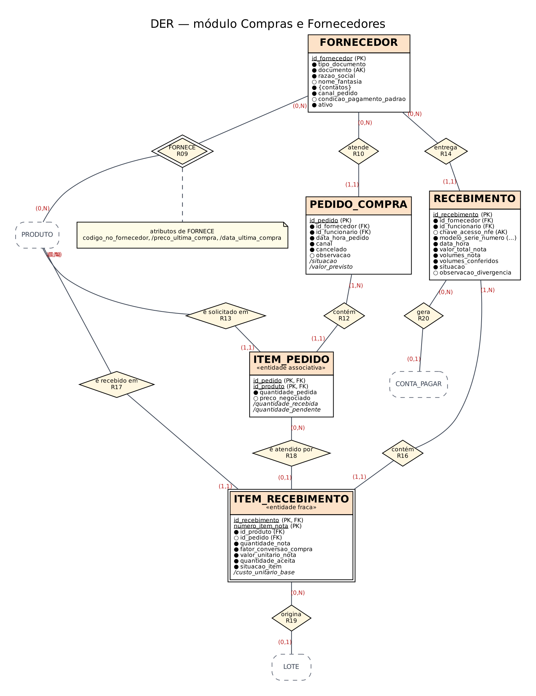
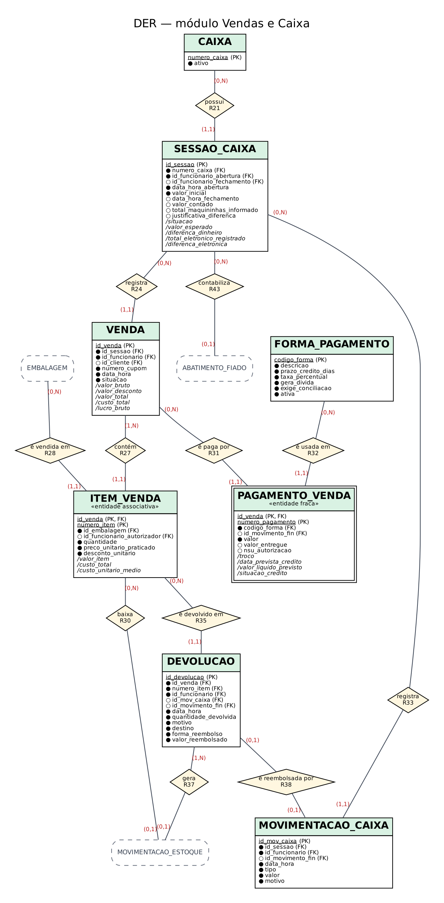
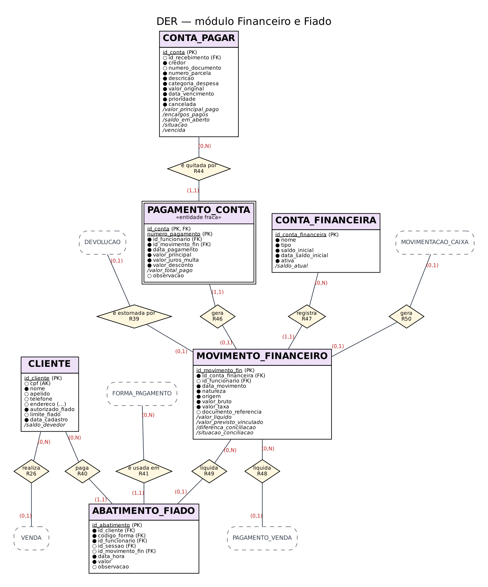
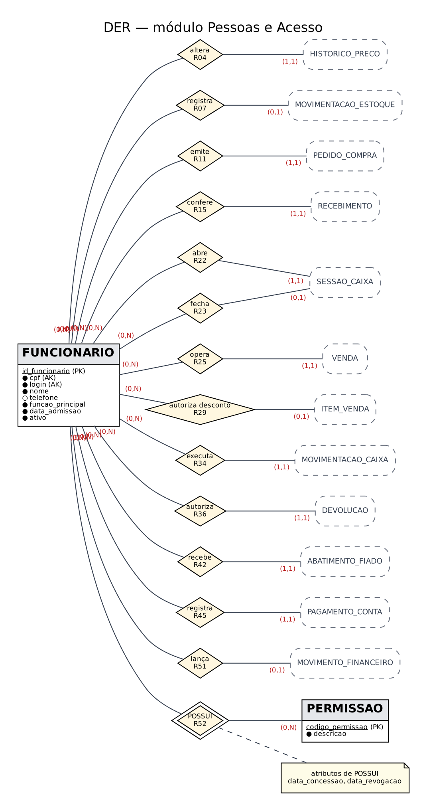

# Revisão da primeira entrega — alterações do modelo

*Extraído da seção 2 do documento da entrega final (`docs/entrega-final/Grupo_03.pdf`).*

## 2.1 Como a revisão foi feita

A primeira entrega já havia sido revisada uma vez, para atender aos seis pontos da devolutiva (identificação dos lotes, custo da venda, escolha das chaves, pagamentos parciais, conciliação e validação das cardinalidades). Aquela versão revisada é o ponto de partida desta entrega e está no repositório em `docs/entrega-1-revisada/`.

Nesta fase o modelo foi revisado de novo, agora por quatro caminhos que só existem depois que o banco é construído:

1. **Conversão para o modelo lógico.** Cada entidade, atributo e relacionamento foi convertido e conferido automaticamente contra o DER (seção 3.3).
2. **Normalização.** Cada tabela foi verificada quanto às dependências funcionais (seção 4). Três atributos que o DER tratava como gravados se mostraram dependentes de outros dados.
3. **Simulação de 30 dias de operação.** Ao rodar o negócio inteiro — compras, vendas, caixa, fiado, contas — apareceram situações que o modelo não tratava bem (exemplo: a compra paga à vista não deixava registro da saída do dinheiro).
4. **Consultas de auditoria.** Uma auditoria acusou como irregulares alterações de preço legítimas, porque o modelo não guardava *quando* uma permissão tinha sido retirada. O erro estava no modelo, não nos dados.

## 2.2 Quadro de alterações

O quadro segue o formato pedido pelo manual. A parte A resume as decisões de modelagem que mudaram na revisão pós-devolutiva, já incorporadas à primeira entrega revisada. A parte B traz o que mudou **nesta fase** — são as alterações que um leitor da primeira entrega revisada ainda não conhece.

**Parte A — alterações da revisão pós-devolutiva (primeira entrega revisada)**

| O que foi alterado | Como era | Como ficou | Por que alteramos |
|---|---|---|---|
| Identificação do LOTE | PK (cnpj_fornecedor, numero_nota, nome_produto): um lote por produto em cada nota | LOTE com identificador próprio, ligado à linha da nota (ITEM_RECEBIMENTO); uma linha com duas validades gera dois lotes | A mesma nota traz o mesmo produto com validades diferentes; e existem lotes sem nota (inventário inicial, reposição de troca). Ponto 1 da devolutiva |
| Custo da mercadoria vendida | Um custo copiado no item de venda | Custo = soma, por lote baixado, de quantidade × custo do lote (uma movimentação por lote) | Um item pode consumir dois lotes de custos diferentes; o custo único dava lucro errado. Ponto 2 |
| Critério das chaves primárias | Chaves naturais em todas as entidades (nome do produto, CPF, CNPJ, data/hora) | Critério misto: natural só para códigos estáveis do mercado; substituta para cadastros e eventos; composta (dona + discriminador) para entidades fracas; candidatas naturais mantidas como UNIQUE | Nomes mudam, data/hora colide (duas vendas no mesmo segundo), CPF não deve circular nas tabelas operacionais (LGPD). Ponto 3 |
| Pagamento de contas | FUNCIONARIO — quita — CONTA_PAGAR: uma quitação por conta | Entidade fraca PAGAMENTO_CONTA: vários pagamentos por conta, cada um com juros, desconto e origem do dinheiro | O mercado paga boletos em parte quando o caixa não cobre tudo (PO-06). Ponto 4 |
| Fechamento, conciliação e previsão | Tratados como um único controle | Três conceitos: fechamento da sessão de caixa; conciliação de cada transação com o crédito real (CONTA_FINANCEIRA, MOVIMENTO_FINANCEIRO); previsão como cálculo | Fechar o caixa não prova que o cartão caiu na conta; a previsão não é um registro. Ponto 5 |
| PEDIDO_COMPRA — PRODUTO | Relacionamento N:N SOLICITA | Entidade associativa ITEM_PEDIDO | O item pedido precisa se relacionar com o item recebido (faltante que chega depois) |
| PEDIDO_COMPRA — RECEBIMENTO | Vínculo entre cabeçalhos | ITEM_PEDIDO — é atendido por — ITEM_RECEBIMENTO | Só no nível do item se sabe o que ainda falta chegar |
| PAGAMENTO_VENDA | PK (caixa, data/hora da venda, forma): um registro por forma | PK (venda, sequência) + NSU | Duas transações na mesma forma (dois cartões) e conciliação por transação |
| Devoluções | Sem entidade | Entidade DEVOLUCAO ligada ao item vendido, ao estoque e ao dinheiro | A troca/devolução movimenta estoque, caixa e fiado |
| Cardinalidades | Não testadas | 15 cenários reais percorridos ocorrência por ocorrência | Ponto 6 da devolutiva |

**Parte B — alterações feitas nesta fase (construção do modelo lógico, normalização, simulação e auditoria)**

| O que foi alterado | Como era | Como ficou | Por que alteramos | Como foi descoberto |
|---|---|---|---|---|
| RN-31 e R20 (RECEBIMENTO — gera — CONTA_PAGAR) | Compra paga à vista no ato **não** gerava conta a pagar | Compra à vista gera **uma** conta quitada no ato (com o pagamento e a saída de dinheiro); boleto gera parcelas; só o recebimento recusado não gera conta | Sem a conta, o dinheiro que saiu do cofre para pagar o fornecedor não aparecia em lugar nenhum: o saldo do cofre ficava maior que o real e a previsão (RF-35) errava | Simulação: o saldo do cofre não fechava com as compras à vista |
| SESSAO_CAIXA.situacao | Atributo gravado (ABERTA/FECHADA) | Derivado de data_hora_fechamento (view) | Dependência transitiva: id_sessao → data_hora_fechamento → situacao. Podia existir sessão “ABERTA” com data de fechamento | Normalização (3FN) |
| LOTE.quantidade_inicial | Atributo gravado | Derivado: quantidade da movimentação de entrada | A mesma informação ficava em dois lugares (lote e movimentação de entrada) e podia divergir | Normalização (redundância) |
| LOTE.situacao | DISPONIVEL, SEPARADO_TROCA, ESGOTADO, DESCARTADO | DISPONIVEL, SEPARADO_TROCA, **TROCADO**, DESCARTADO | “Esgotado” é saldo zero (derivado). Faltava o estado final do lote que o fornecedor trocou (RN-19) | Normalização + simulação da troca |
| LOTE.pendente_conferencia | Não existia | Indicador nos lotes de ajuste automático | RN-40 dizia “gera uma pendência”, mas o modelo não tinha onde guardá-la | Construção da auditoria A11 |
| FORNECE.preco_ultima_compra e data_ultima_compra | Atributos gravados no par fornecedor–produto | Derivados das notas recebidas (view `vw_ultimo_custo_fornecedor`) | Duplicavam o que já está na linha da nota; bastava esquecer de atualizar para o sistema sugerir o fornecedor errado | Normalização (redundância) |
| POSSUI (FUNCIONARIO — PERMISSAO) | Atributo data_concessao; PK (funcionário, permissão); revogar = apagar a linha | Atributos data_concessao e **data_revogacao**; PK inclui data_concessao; revogar = registrar a data | Apagar a permissão fazia a auditoria acusar como irregulares as alterações de preço feitas **antes** da revogação (falso positivo). Quem podia o quê precisa ser sabido em cada data (RNF-02) | Auditoria A13 depois do script de operações |
| R31 (VENDA — é paga por — PAGAMENTO_VENDA) | VENDA (1,N) | VENDA (0,N), com a regra “venda concluída tem ao menos um pagamento e a soma fecha o total” | A venda cancelada antes do pagamento não tem pagamento. O mínimo 1 vale para a venda concluída, e isso é verificado pela auditoria A01 | Massa de dados (vendas canceladas) |
| Valor esperado na gaveta (RF-32) | Incluía o recolhimento do fechamento | Não inclui o recolhimento | O dinheiro é contado antes de ser recolhido ao cofre; incluir o recolhimento acusava falta inexistente em todo fechamento | Simulação do fechamento |
| Documento do fornecedor | CNPJ numérico (14 dígitos) | CNPJ numérico ou alfanumérico (12 posições alfanuméricas + 2 dígitos verificadores) ou CPF | O CNPJ alfanumérico começou a ser atribuído em julho de 2026 (BRASIL, 2024); os números antigos continuam válidos | Verificação na fonte oficial ao definir o tipo de dado |

Nenhuma entidade foi criada ou eliminada nesta fase. Isso é uma informação relevante: as correções da devolutiva resolveram a estrutura; o que o banco revelou foram atributos gravados que deviam ser calculados, um estado que faltava, uma regra que não fechava o dinheiro e uma cardinalidade mínima que a massa de dados desmentiu.

## 2.3 Regras e requisitos atualizados

Só estão abaixo as regras e requisitos que mudaram nesta fase; os demais permanecem como na primeira entrega revisada (lista completa e atualizada em `docs/requisitos/` no repositório).

| ID | Texto atualizado | O que mudou |
|---|---|---|
| RN-31 **[alterada]** | Todo recebimento aceito gera contas a pagar conforme a condição acordada: compra à vista gera uma conta quitada no ato, com o pagamento e a saída de dinheiro registrados; compra a prazo gera uma conta por parcela (boletos em 7, 14 e 21 dias). Recebimento recusado não gera conta. | Antes, a compra à vista não gerava conta e a saída de dinheiro se perdia |
| RN-21 **[esclarecida]** | Toda venda tem ao menos um item. A venda **concluída** tem ao menos um pagamento, e a soma dos pagamentos (já líquidos de troco) é igual ao total; a venda cancelada antes do pagamento não tem pagamento nem baixa de estoque. | Explicita por que VENDA — PAGAMENTO_VENDA é (0,N) |
| RN-19 **[alterada]** | O lote vencido é retirado e fica SEPARADO_TROCA. Se o fornecedor trocar, o lote passa a TROCADO e a reposição entra como novo lote vinculado a ele, com o mesmo custo; se não trocar, o lote é DESCARTADO. “Esgotado” não é situação: é saldo zero. | Novo estado TROCADO; ESGOTADO deixa de ser gravado |
| RN-40 **[alterada]** | (texto anterior mantido) … e o lote de ajuste fica marcado como **pendente de conferência** até a contagem física, quando o ajuste é confirmado ou corrigido. | A pendência passou a ter onde ser registrada |
| RN-42 **[nova]** | Toda permissão tem período de vigência: data de concessão e, se retirada, data de revogação. Revogar não apaga o registro. Uma operação sensível é válida se o funcionário tinha a permissão **na data da operação**. | Corrige o falso positivo da auditoria A13 |
| RF-07 **[alterado]** | O sistema deverá informar, para cada par produto–fornecedor, o custo e a data da última compra, **calculados a partir das notas recebidas**, permitindo comparar fornecedores do mesmo item. | Antes os valores eram gravados no par |
| RF-13 **[alterado]** | O sistema deverá gerar as contas a pagar do recebimento conforme RN-31, inclusive a conta quitada no ato da compra à vista. | Alinhado à RN-31 |
| RF-32 **[alterado]** | O valor esperado na gaveta é: fundo inicial + pagamentos em dinheiro (líquidos de troco) + abatimentos em dinheiro + suprimentos − sangrias − reembolsos em dinheiro. O recolhimento do fechamento acontece **depois** da contagem e não entra. | Retirado o recolhimento |
| RF-42 **[alterado]** | O controle de acesso por permissão individual guarda a data de concessão e a de revogação de cada permissão (RN-42). | Histórico de permissões |

## 2.4 DER atualizado

O DER foi regenerado a partir da mesma fonte usada na primeira entrega revisada, com as alterações da parte B. A notação é a mesma: PK sublinhada, atributo derivado com barra (/), opcional com círculo vazio e cardinalidades (mínimo, máximo) nos dois lados de cada relacionamento.

*Figura 1 – Legenda da notação do DER.*

*Figura 2 – DER revisado: visão geral das 27 entidades e 52 relacionamentos (sem atributos).*

*Figura 3 – DER do módulo Produtos e Estoque (LOTE com situação TROCADO, pendente_conferencia e /quantidade_inicial).*

*Figura 4 – DER do módulo Compras e Fornecedores (FORNECE com /preco_ultima_compra e /data_ultima_compra derivados).*

*Figura 5 – DER do módulo Vendas e Caixa (SESSAO_CAIXA com /situacao derivada; VENDA (0,N) — PAGAMENTO_VENDA).*

*Figura 6 – DER do módulo Financeiro e Fiado.*

*Figura 7 – DER do módulo Pessoas e Acesso (POSSUI com data_concessao e data_revogacao).*

O DER completo, com todos os atributos em uma única figura, está em `docs/diagramas/der/der-completo.svg` (formato vetorial, para ampliar sem perder definição).

